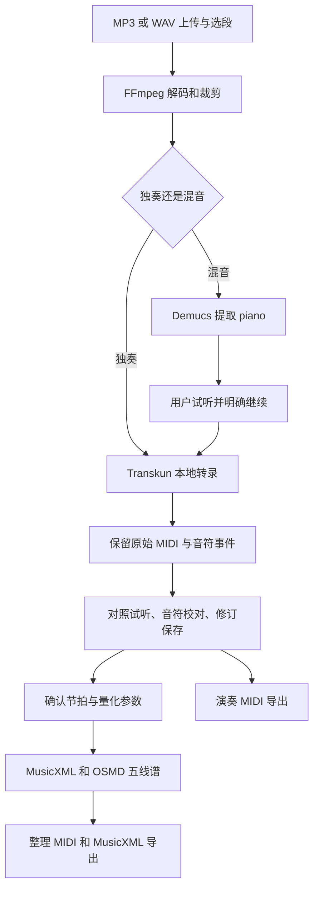

# NeoNote 项目介绍与面试准备

本文依据当前项目文档整理，重点介绍 AI 编曲、钢琴扒谱及相关工程实现。个人贡献部分提供表达模板，使用时按自己实际参与、理解和能够演示的工作调整。

## 1. 一分钟项目介绍

> 我做的项目叫 NeoNote，是一个面向音乐新手的本地音乐平台，包含创作、练习和扒谱三个入口。前端使用 React 和 TypeScript，后端使用 FastAPI 和 Python。
>
> 核心功能有两个。第一个是 AI 编曲：用户输入歌词、情感描述或弹奏片段，系统调用 DeepSeek 生成结构化音乐规划，再由程序转换成键盘、鼓、吉他、贝斯四个声部，支持编辑、试听和 MIDI 导出。
>
> 第二个是钢琴扒谱：用户上传 MP3 或 WAV，通过 Transkun 识别钢琴音符，生成 MIDI；混音场景先用 Demucs 尝试分离钢琴。用户可以对照原音频校对，再整理成五线谱。
>
> 我的工作重点是把这些能力组织成可使用的产品，包括音乐数据转换、结果校验、音符编辑，以及任务状态和版本管理，让模型输出能够继续修改、试听和保存。

简短概括：**AI 编曲把创作意图变成乐谱，扒谱把已有声音还原成可编辑乐谱。**

## 2. 技术栈与职责

| 技术 | 项目中的职责 |
| --- | --- |
| React、TypeScript | 输入、编辑、试听控制和任务状态展示 |
| FastAPI、Python、Pydantic | 接口、音乐数据校验、编配、任务与文件管理 |
| DeepSeek API | 理解歌词、主题、情感和演奏参考，输出音乐规划 |
| Mido、MIDI | 音符事件与轨道读写，保存可编辑演奏信息 |
| Transkun 2.0.1、PyTorch 2.8 CPU | 钢琴复音转录，识别音高、起止时间和力度 |
| Demucs 4.0.1、htdemucs_6s | 试验性提取混音中的钢琴音轨 |
| FFmpeg | 音频解码、片段处理和音频格式转换 |
| MusicXML、OSMD | 表达节拍、声部和记谱结构，渲染五线谱 |
| SoundFont、FluidSynth | MIDI 器乐试听及 WAV 渲染，结合 FFmpeg 导出 MP3 |

中文演唱还使用 DiffSinger 音源和 OpenUtau Core 的独立 C# 宿主；面试开场可以先聚焦编曲和扒谱，再按追问展开。

## 3. AI 编曲的实现流程

### 3.1 以当前默认全文歌词流程为例

1. 后端整理歌词原文、行号和字词，将主题、曲风及旋律参考作为生成条件。
2. 默认 `lyric-motifs-v1` 合同要求模型规划逐句旋律型、句尾收束、和声、速度和音色。
3. 程序按歌词顺序展开旋律单元，同时创建实际音符 ID 和歌词绑定；按共同小节与和声安排基础伴奏、换气和器乐段。
4. 检查结构、音域、时长、音符数量、歌词覆盖和原演奏保留约束。
5. 合格结果作为候选，由用户试听、采用和保存；后续可以手动编辑或发起自然语言整曲修改。

**职责划分：模型负责音乐规划，程序负责确定性的音符创建、对应关系、基础编配与校验。** 当前伴奏包含程序节奏型，面试时应如实说明这一方法。

有歌词时一次处理全文，时长由实际编配决定；无歌词时保留 60 秒短曲审核后明确扩展的流程。另有 `lyric-phrases-v2` 乐句与音符组试验入口，与默认 v1 区分介绍。

### 3.2 可以展开讲的技术难点

| 难点 | 采用的方法 | 解决的问题 |
| --- | --- | --- |
| 模型同时维护音符表和歌词编号容易失配 | 程序展开歌词时同步创建音符及绑定 | 减少漏词、编号越界和对应错位 |
| 要求模型复制原旋律不可靠 | 保留模式由程序固定原演奏，模型从参考窗口后延展 | 音高、时间、力度及乐器信息可直接检查 |
| 四声部需要时间与和声一致 | 使用共同小节、速度、和声规划进行程序编配 | 各声部能够在同一时间轴播放 |
| 结构正确和实际好听是两类判断 | 程序检查结构，用户试听和试唱后审核 | 将软件检查与音乐效果验收分开 |
| 修改或失败可能影响原作品 | 候选显式采用、不可变版本、失败保留旧结果 | 可以比较、恢复和追溯 |

### 3.3 一个实际问题的讲法

> 早期方案让模型分别生成主旋律音符和歌词对应编号，出现过主旋律只有 57 个音符，却引用编号 57 的情况，有效编号实际上是 0 到 56。后来调整生成合同，让模型给出逐句旋律型，由程序在展开歌词时同时创建音符和对应关系。这样减少了模型维护全局编号的负担，也便于在程序中检查歌词覆盖。

这个案例适合回答“遇到过什么问题、为什么这样设计”。依据见[全文歌词谱曲重写](lyrics-rewrite-20261006.md)。

## 4. 钢琴扒谱的实现流程

### 4.1 每一步在做什么

- **音频准备：** 检查文件和片段范围，通过 FFmpeg 解码。当前上传限 100 MiB、10 分钟，单次片段最多 60 秒。
- **声源分离：** 混音使用 Demucs 六声部模型的 piano 输出。分离可能有串音或音符缺失，因此先试听确认，再转录。
- **音符转录：** Transkun 基于音频预测音高、起音、结束和力度，输出 MIDI；当前完成的是本地 CPU 推理集成。
- **人工校对：** 用户对照原音频、分离结果和 MIDI，修改音高、开始、结束、力度及左右手，保存新的修订。
- **谱面整理：** 用户确认 BPM、拍号、第一强拍和量化设置，再组织小节、复调声部、休止符与延音线，输出 MusicXML 并由 OSMD 显示。

### 4.2 三种结果为什么分开保存

| 结果 | 用途 |
| --- | --- |
| 原始转录 MIDI | 保留模型原始输出，用于追溯和重新处理 |
| 选段／校对后的演奏 MIDI | 表达当前选段或人工校对后的演奏事件 |
| 整理 MIDI 与 MusicXML | 表达量化后的节拍和谱面结构，便于读谱 |

实际演奏存在提前、延后和自由速度。量化会改变谱面使用的节奏表达，保留原始结果可以帮助用户比较和修正。

### 4.3 可以展开讲的技术难点

| 难点 | 当前处理方法 |
| --- | --- |
| 混音分离误差会传递给转录 | 试验入口、分离后试听确认、原音频与结果对照 |
| 模型补帧产生片段外音符 | 保留原始 MIDI，另生成选段结果及边界诊断；片段内起音的持续音在终点截断 |
| 钢琴同一只手可能包含多条重叠旋律 | 动态分配记谱声部编号，支持每手最多 32 声部，保留重复音和延音关系 |
| 粗量化可能将短音变成零时长 | 返回具体问题，保留校对和演奏 MIDI，允许调整网格或音符后重新整理 |
| CPU 推理耗时，取消可能留下子进程 | 独立工作进程、任务并发限制、Windows Job Object 管理进程生命周期 |
| 重启、失败或再次处理影响已有结果 | 中断状态记录、显式新任务、完整校验后发布、不可变修订 |

**一个具体案例：** 原记谱逻辑每只手只有两个声部编号，真实转录材料需要更多重叠声部。后续引入动态 `voice_stride`，为左右手划分互不冲突的声部编号，同时兼容旧记谱数据。依据见[扒谱边界与复调修复](transcription-fixes-20261028.md)。

## 5. 面试常见问题与参考回答

### Q1：DeepSeek 为什么能用于编曲？

音乐可以表示为音高、节奏、和声和乐器等结构化信息。我们让 DeepSeek 根据创作要求输出音乐规划，再由程序生成 MIDI，通过音源渲染出声音。这种方式便于编辑和校验，音乐表现由试听判断。

### Q2：为什么不让模型直接输出 MIDI？

MIDI 是二进制格式，直接生成不方便验证。即使输出完整音符 JSON，长歌词也容易出现编号、覆盖和时长错误。因此默认歌词流程让模型输出较高层的规划，程序负责展开音符和绑定关系。

### Q3：歌词与音符怎么对应？支持一字多音吗？

程序展开歌词时同步创建实际音符 ID，将字词绑定到一个或多个音符，再校验覆盖与引用。一字多音可以表示；实际演唱中的发音、重音和旋律自然度需要另行试听检查。

### Q4：原演奏如何保留？

保留模式将原演奏固定为无词前缀，保留音高、时间、力度及 Program/Bank 等信息，再让生成部分从参考窗口之后开始。程序检查这些约束，而自由改编的走向是否合适通过人工对照判断。

### Q5：生成出错会怎样？

不符合结构或音乐约束的结果会返回失败诊断，不发布为成功候选，也不覆盖旧作品。成功候选需要用户明确采用，保存后形成新版本。

### Q6：扒谱和 DeepSeek 有关系吗？

扒谱使用本地音频模型：Demucs 处理声源分离，Transkun 处理钢琴音符识别。DeepSeek 用在创作入口，两条业务流程独立。

### Q7：为什么选择 Transkun？

项目目标是钢琴转录，和弦与重叠音符要求模型支持复音。Transkun 面向钢琴，输出可编辑 MIDI，也可以本地推理，适合当前产品范围。选型依据是任务匹配和集成可行性。

### Q8：MIDI 为什么还需要转换成 MusicXML？

MIDI 主要描述演奏事件，MusicXML 还能明确表达小节、音符时值、声部和休止符等记谱信息。我们先确认节拍并量化，再生成 MusicXML，由 OSMD 展示。

### Q9：系统会自动识别歌曲的 BPM 和原谱吗？

当前由用户确认 BPM、拍号和第一强拍，默认 BPM 是可调整的初值。系统根据转录音符和这些参数整理谱面，输出的是可校对的转录结果，准确性取决于音源、模型输出和人工校对。

### Q10：准确率和性能怎么样？

已完成真实 CPU 推理、MIDI 导出和谱面整理的技术验证。当前没有大规模准确率评测；已有材料中出现过额外短音和混音串音，因此产品提供对照试听与人工校对。具体耗时需要连同硬件、片段长度和是否分离一起说明。

### Q11：现成模型之外，你做了什么？

我的工作集中在产品设计和工程集成：设计音乐数据结构与生成合同，组织歌词展开、数据校验、音符编辑和谱面整理；同时处理任务取消、版本冲突和文件保存，让模型结果能被用户继续使用。具体负责范围按实际经历展开。

### Q12：长任务怎么管理？

扒谱由工作进程执行，前端展示实际阶段并允许取消。当前最多一个推理任务，取消时回收子进程后才释放并发名额。重启时将未完成任务标为中断，用户重新发起会创建新任务，成功结果通过完整校验后发布。

### Q13：如何避免修改和导出版本混乱？

原始资料保留，编辑保存为不可变版本或修订，导出文件绑定对应版本。保存检查当前修订，冲突时拒绝覆盖；失败保留已有成功结果，便于恢复和比较。

### Q14：三个入口的数据怎么组织？

创作使用 `data/<歌曲ID>`，练习使用 `data/.practice`，扒谱使用 `data/.transcriptions`。各模块管理自己的记录和任务，扒谱到练习、创作的自动复制目前属于扩展接口。

### Q15：你会优先优化什么？

优先改进新手校对体验。编曲侧帮助用户判断歌词和旋律是否合适；扒谱侧改善原音频、音符与五线谱的定位和对照，让用户更容易找到并修正错误。

### Q16：是否使用 AI 辅助开发？

如果实际使用，可以这样讲：开发中使用了 AI 辅助方案讨论、代码草拟和问题排查。我负责的具体工作包括需求取舍、方案核对、修改与验证，并能解释关键模块的输入输出和失败处理。结合真实参与情况举例，代码来源与本人掌握程度如实说明。

## 6. 如何体现自己的工作

按“做了什么、为什么、如何验证”准备每个例子。下面是可选择的方向，不代表已经确认由你独立完成。

| 工作方向 | 可使用的表达 | 面试前需要准备 |
| --- | --- | --- |
| 产品与范围设计 | 我把功能拆成创作、练习和扒谱三个独立入口，并为新手保留试听、校对和明确采用的操作 | 实际界面与流程选择原因 |
| AI 生成合同 | 我参与将完整音符编号输出改为逐句音乐规划与程序展开 | 旧编号越界案例、v1 输入输出和展开代码 |
| 音乐数据转换 | 我负责／参与统一音符与歌词对应，并完成 MIDI、谱面和音频之间的转换 | 一组音符如何保存、导出和显示 |
| 扒谱集成 | 我负责／参与衔接 FFmpeg、Demucs、Transkun 与谱面整理 | 独奏、混音的流程差异及实际校对示例 |
| 稳定性 | 我负责／参与任务取消、失败保护和不可变修订 | 一次取消、冲突或失败后的恢复演示 |
| 验证与排查 | 我区分软件检查与实际听感，保留失败材料并定位原因 | 一份真实问题记录及对应修复 |

如果问到项目难点，可以回答：

> 一个难点是不同环节对音乐的表示不同。模型给出音乐规划，MIDI 记录演奏事件，五线谱表达节拍结构，音频按秒播放。我需要处理这些表示之间的转换，并保留原始结果与版本关系，让用户能够校对和追溯。

## 7. 面试前的演示与复习清单

1. 准备一首已有的 AI 作品：展示输入、四声部、歌词对应、手动修改和导出。使用已有成功结果即可，不依赖现场 API 返回。
2. 准备一个短钢琴片段：展示原音频、转录 MIDI、一次音符校对及五线谱；混音作为额外例子，说明分离试听步骤。
3. 准备一个失败案例：解释编号越界、量化零时长或片段边界问题，以及系统如何保留原结果。
4. 熟悉基本概念：音高、起止时间、力度、BPM、拍号、PPQ、复音、量化、MIDI 与 MusicXML 的区别。
5. 根据实际贡献圈定 2–3 个可深入讲解的模块，准备代码、界面和验证材料。

## 8. 代码与文档定位

| 内容 | 阅读入口 |
| --- | --- |
| 项目使用与目录 | [README](../README.md) |
| AI 生成与歌词编配 | [composition.py](../backend/app/composition.py)、[lyric_composition.py](../backend/app/lyric_composition.py) |
| 默认歌词方案及真实问题 | [全文歌词谱曲重写](lyrics-rewrite-20261006.md) |
| 乐句级试验功能 | [乐句与转音交付](lyric-phrases-delivery-20261012.md) |
| 扒谱任务与工作进程 | [transcriptions.py](../backend/app/transcriptions.py)、[transcription_worker.py](../backend/app/transcription_worker.py) |
| 扒谱记谱 | [transcription_score.py](../backend/app/transcription_score.py) |
| 扒谱安装、方法和真实验收 | [扒谱交付](transcription-delivery-20261028.md) |
| 片段边界与多声部修复 | [扒谱修复](transcription-fixes-20261028.md) |
| 音色渲染与演唱 | [音频渲染](stage2.md)、[演唱交付](vocal-delivery-20261010.md) |

技术版本和实现范围以对应交付文档及当前代码为准。面试中的性能、准确率和个人贡献使用自己能够解释和提供依据的表述。
