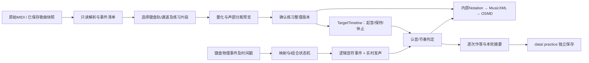
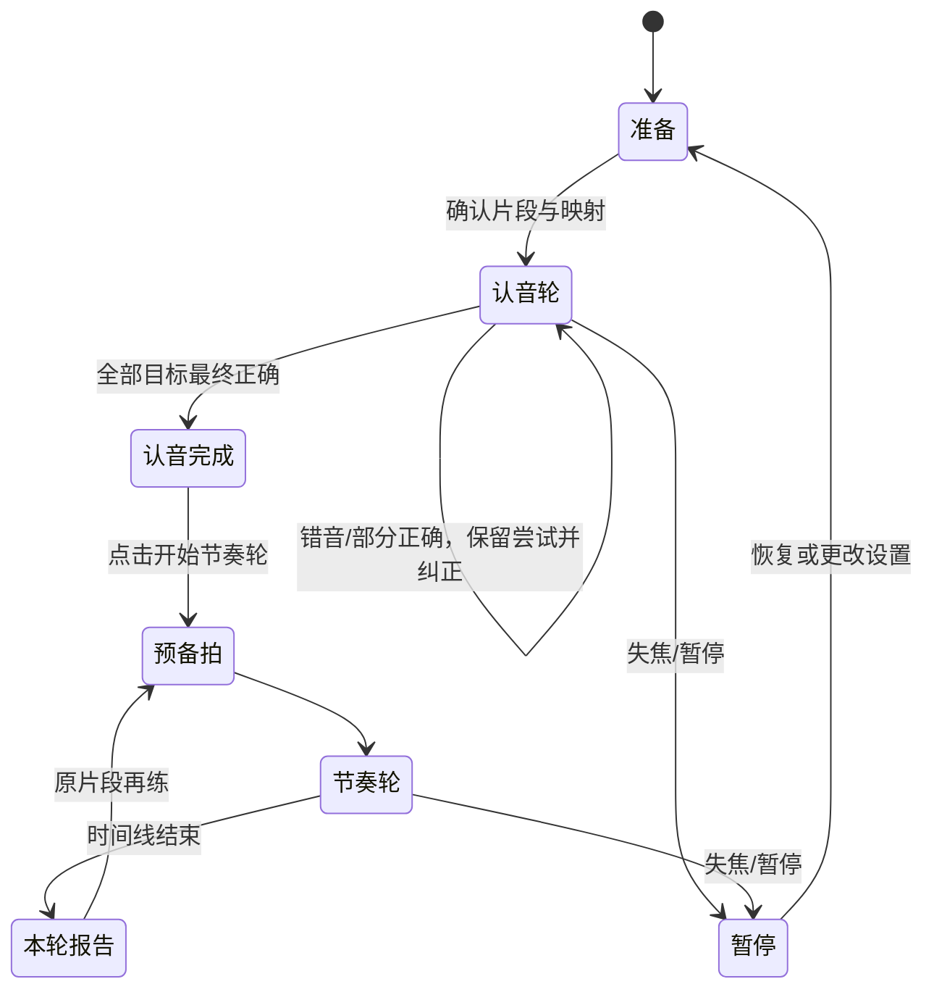

# NeoNote：识谱与节奏练习设计

2026-10-14补充：在现有MIDI自选材料之外加入本地基础单元，5单元15条原创2–4小节谱；不需要上传MIDI或先创作。使用相同五线谱、键位、两轮及保存合同，谱面仍需明确核对。当前教材定义、版本身份、入口及验收见[单元练习交付](practice-units-delivery-20261014.md)。单元进度只统计相同教材内容版本的记录，认音完成、完整节奏练过与达到建议标准分开；不自动迁移旧记录或把部分续练拼为完整成绩。

日期：2026-10-13。最初的只读设计后，用户已授权实施。本次新增OSMD依赖、正式练习模块和隔离自动化检查；真实API、歌声推理均为0，未访问真实.env。当前实现及人工待验以[实际交付记录](practice-delivery-20261013.md)为准。下文产品/评分建议未实现的部分由交付差异表标明，不能以设计代替事实。

## 1. 决策摘要与需求状态

主推荐：**React练习入口 + OSMD的SVG五线谱 + 项目内部记谱结构/MusicXML + Mido独立练习导入 + 现有SoundFont发声 + 前端纯函数输入/评分状态机 + 后端独立JSON练习记录。** 不引入AI、歌声模型、SQLite或新的Python环境。

已确认：练习/创作两个自选入口；MIDI选键盘声部和片段；标准五线谱；先认音再音高＋节奏；用户指定s–l/e/r/y/u/i映射；实施时确认Shift/空格单按切档、按住叠加，l始终普通高C，仅练习启用。

**本轮用户补充确认：认音轮允许出错后纠正，全部目标最终按对即可进入节奏轮；保留练习作答记录。** 首次准确率和完整尝试记录独立保存，完成后不把此前错误清零。另一种“整轮首次全对才解锁”仅保留为未来挑战模式，不作为默认阻挡条件。

实施时三项选择已集中确认，新的确定性规则见第6节，旧l等待方案不实施。评分容差仍是首版工程默认，随规则快照保存；实体键盘、设备延迟及听感另验。

## 2. 参考产品核实范围

本轮读取了[TypePiano公开首页](https://typepiano.org/en)。页面展示五线谱识音、电脑/屏幕/MIDI键盘入口、即时视听反馈，以及准确率、速度和薄弱音统计的产品介绍；页面电脑键位是数字1–7等，与NeoNote本轮指定键位不同。借鉴“看谱→按键→反馈”及短片段反复练习，不照搬键位或完整系统。

核实方式为公开网页内容读取，未运行交互页面、连接键盘或实测评分。无法据此确认它的MIDI导入、和弦聚合窗口、两轮解锁、节奏容差或l键机制。[B站视频BV1Q3hQ6yEPp](https://www.bilibili.com/video/BV1Q3hQ6yEPp/)通过当前网页工具无法访问，本轮未观看视频、未取得字幕；不以视频内容作为功能事实。下文交互和算法为NeoNote设计。

## 3. 实施前代码核对基础（历史快照）

| 位置 | 代码核对事实 | 复用与新增 |
| --- | --- | --- |
| [App.tsx](../frontend/app/src/App.tsx) | 当前inputs/edit/files三个创作视图；仅inputs捕获演奏keydown；忽略repeat、Ctrl/Alt/Meta、输入框和弹窗，keyup按code释放，blur/隐藏页面停止。 | 保留创作状态；新增应用级入口、练习工作台和统一输入所有权。两个入口不能同时监听发声。 |
| [music.mjs](../frontend/app/src/music.mjs) | 旧KEY_CODES是A/W/S/E/D/F/T/G/Y/H/U/J/K，按半音递增；secondsAt/tickAtSeconds遍历完整速度图，playbackEvents按静音/独奏提取事件。 | 复用时间换算和事件模型；练习键位另建配置，不能只替换全局数组。noteName当前一律升号，不能用它决定五线谱升降号拼写。 |
| [audio.ts](../frontend/app/src/audio.ts) | SpessaSynth AudioWorklet加载本地SF2；voice返回停止闭包，按channel:pitch计引用；Sequencer在音频线程播放，UI每50ms取进度；AudioContext目前私有。 | 复用SF2加载/发声，新增公开练习时钟/音频调度接口。50ms进度轮询不能作为评分时钟；播放和练习实时声部分开通道，避免同音noteOff干扰。 |
| [midi.py](../backend/app/midi.py) | Mido解析Type0/1、正PPQ，转换480PPQ仅舍入；保留tempo、拍号及部分meta；默认缺省tempo=120、拍号4/4、program=0。按轨道＋通道分组，但拒绝多轨共用通道、途中控制/音色、CC64踏板、弯音/SysEx等。 | 可复用基础解析逻辑和时间换算，新增独立练习检查层保存原事件/来源与缺省标记。现有默认钢琴不是原文件明确指定钢琴的证据。 |
| [models.py](../backend/app/models.py) | Score是480PPQ，含音符id/pitch/velocity/start/duration、速度图、拍号、MIDI元信息；16轨/5000音符/10分钟；没有谱号、声部voice、休止、连线、音名拼写结构。 | 演奏事件不能直接当完整乐谱。新增PracticeNotation与TargetTimeline，保持SongState不变。 |
| [main.py](../backend/app/main.py) MIDI上传 | 当前导入接口替换歌曲score、清除composition，再保存歌曲版本。 | **练习不可调用此写歌曲接口**；新增独立/api/practice路径。 |
| [storage.py](../backend/app/storage.py) | 歌曲目录名只识别32位hex，project/revisions显式保存、原子写入和冲突检查。 | 复用安全写入方法的设计，新增PracticeStore；data/.practice不会被歌曲列表识别，仍须回归验证。 |
| [package.json](../frontend/app/package.json)、[requirements.txt](../requirements.txt) | React19.3/TS7/Vite8；spessasynth_lib4.3.14/core4.3.22；Python已有Mido1.3.3、FastAPI/Pydantic。没有五线谱库。 | 推荐新增一个直接前端依赖opensheetmusicdisplay，安装时锁定版本与传递依赖。本轮不安装，不宣称已与现有构建组合验证。 |

现有歌词练唱与音符组试听属于创作辅助，继续保留；其按歌词定位不能直接承担MIDI识谱目标、作答和两轮评分。

## 4. 五线谱选型（最多三个候选）

| 候选 | 官方接口与许可 | 本项目取舍 |
| --- | --- | --- |
| **OSMD，主推荐** | TypeScript MusicXML排版，SVG后端；`new OpenSheetMusicDisplay(container, options)`、`load(xml)`、`render()`；Cursor提供next/reset/NotesUnderCursor/GNotesUnderCursor；GraphicalNote提供sourceNote、PositionAndShape、setColor。BSD-3-Clause。 | MusicXML便于完整小节、多声部与连线排版；适合显示、点击和反馈。需要自建MIDI记谱、稳定ID映射与评分，不使用其额外音频播放器。 |
| VexFlow，备选 | JS/TS、SVG/Canvas；Renderer、Stave、StaveNote、Voice、Formatter，以及StaveTie/Curve/Tuplet等记谱对象；MIT。 | 内部记谱结构可直接生成对象，音符身份容易掌控；分页、系统布局、跨小节/跨系统连线和复杂谱需更多自建代码。适合OSMD无法满足局部高亮时再比较，不同时维护两套正式渲染。 |
| Verovio | C++内核的JS/WASM工具包，MEI为中心，可载入MusicXML；loadData/renderToSVG、getElementsAtTime/getTimeForElement、按页面和元素ID查询；LGPL v3。 | 元素定位和复杂排版有优势，但增加WASM资产、MEI转换与分发许可维护。当前新手模块先不引入第二类运行时。 |

官方依据：[OSMD项目与限制](https://github.com/opensheetmusicdisplay/opensheetmusicdisplay)、[入门接口](https://github.com/opensheetmusicdisplay/opensheetmusicdisplay/wiki/Getting-Started)、[Cursor](https://opensheetmusicdisplay.github.io/classdoc/classes/Cursor.html)、[GraphicalNote](https://opensheetmusicdisplay.github.io/classdoc/classes/GraphicalNote.html)、[BSD许可](https://github.com/opensheetmusicdisplay/opensheetmusicdisplay/blob/develop/LICENSE)；[VexFlow教程](https://github.com/0xfe/vexflow/wiki/Tutorial)、[MIT许可](https://github.com/0xfe/vexflow/blob/master/LICENSE)；[Verovio官方说明](https://github.com/rism-digital/verovio)、[工具接口](https://book.verovio.org/toolkit-reference/toolkit-methods.html)、[LGPL条款](https://github.com/rism-digital/verovio/blob/develop/COPYING.LESSER)。

以上为官方文档/源码接口核对，尚未在本项目安装运行。OSMD说明长谱渲染有成本，且不是完整交互编辑器；本方案只用它排版，播放继续现有引擎。三个库都不自动把任意演奏MIDI还原成原出版乐谱。

许可证实施检查：OSMD/VexFlow保留版权与许可；Verovio若采用，需按具体WASM分发方式落实LGPL的源码、修改与替换等条件，不能只写“开源即可打包”。音乐字体和所用乐谱素材许可另列。首版只处理用户本地材料和自制验收谱，不抓取TypePiano曲库。

### 推荐渲染接口边界

内部Notation为权威，MusicXML是版本化派生输出，评分使用TargetTimeline；不通过SVG位置倒推时间。

建立 `notation_id → source_note_ids → attack_id/tie_chain_id` 映射。MusicXML写note的id，同时保存 `(part, measure, voice, onset, chord_index, pitch, segment_index)` 侧表；**不假定OSMD一定原样暴露MusicXML id**。加载后经适配器匹配sourceNote/图形对象，首个原型验证同音多声部、和弦内单音及跨小节拆分的唯一性。

目标高亮优先使用GraphicalNote.setColor（SVG，官方提供免全谱重排的方法）；点击用PositionAndShape建立命中区域，和弦内各音头分别验证。Cursor用于位置导航，但一次next不是一次按键或一次评分目标。缩放/重排后重建命中索引，不依赖临时SVG DOM id。

默认展示选段4–8小节、2–3行谱，当前目标及下一小节保持可见；认音轮推进时按需滚动，节奏轮提前半小节滚到下一行，用户手动滚动后显示“跟随”恢复按钮。长谱按窗口输出MusicXML并携带窗口起点的谱号/调号/拍号/速度、连线跨窗信息，预渲染下一窗口；不在每次keydown重新加载整首谱。跨系统连线和重排后的点击定位列为技术准入测试。

## 5. MIDI到记谱与练习目标



### 导入与轨道选择

1. 原始字节和SHA-256先保存到练习区。预检显示轨名、原轨号/通道、明确program或“未声明”、音符数/音域、速度/拍号与不适用事件。以GM钢琴0–7优先，电钢琴4–5突出，其他键盘类作为候选；轨名是提示，不作权威。鼓通道9不默认进入键盘练习。
2. Type0混轨按通道查看，Type1保留原轨/通道身份；多个轨同通道可在练习解析层单独列出，不套用创作Score的独立通道限制。试听时分配临时通道/统一钢琴，记录这是练习音色。多个候选或缺乐器信息必须让用户选择，不能默认为所有音符。
3. 先选一个轨道，可再选推断的旋律/低音声部；“全部所选声部”需可演奏性通过。未选部分从目标排除但保留原文件、选择记录和完整预览，不算漏音，也不能称为整曲演奏。
4. 首版原始文件上限建议2MiB、5000个note-on、10分钟，Type0/1正PPQ；Type2/SMPTE给原因不强转。原PPQ事件留底，练习480PPQ转换记录舍入误差。
5. 新练习解析器把CC64、表情、pitch bend、途中program、SysEx等列为报告。对踏板可明确选择“按键时长练习，忽略踏板效果”，确认后另存；弯音会改变实际音高，首版目标含弯音时拒绝节奏判定或重新选段。不能默认沿用严格导入器直接拒绝全部常见MIDI，也不能静默忽略控制。

### MIDI能提供与需要推断的信息

MIDI可提供音高编号、note-on/off、力度、轨道/通道、Program/Bank及可能存在的速度、拍号和调号。缺失事件与程序默认值分别保存为 `declared/defaulted`。MIDI通常不提供谱号、左右手、记谱声部、音名拼写、休止符、弱起意图、连梁、延音线、圆滑线和原版排版；这些来自程序整理、用户补充或后续MusicXML输入，必须带来源标记。

| 问题 | 推荐整理规则 |
| --- | --- |
| 量化 | 提供原时间与整理时间对照，默认建议1/16音符网格（480PPQ下120tick），可选1/8或明确三连音网格；分别量化起止并约束正时值/顺序。自动建议不直接保存，显示改动数、最大偏移及原/整理试听，确认后练习按整理谱计时。 |
| 大偏移/自由节奏 | 单音偏移超过局部四分音符时长的1/8或100ms任一较小值，标为需要核对；不自动把琶音吸附成和弦。无法解释的节奏保持原数据，要求更换网格/片段后才能评分。阈值待实测。 |
| 声部分离 | 同起点同终点的不同音高可作一个记谱和弦；不同时值或交叠音用区间分配和音高连续性建议voice，并让用户预览。不能仅按C4一刀切左右手。首版每谱表最多2个voice、可选高/低音大谱表；更复杂部分保留并提示选单声部。 |
| 同音重叠 | 不自动合并；区分不同原voice、踏板尾音、重复起音及坏配对。同手同音重叠在键盘上不可独立表达，要求用户明确整理或选声部。按键时长使用note-off而非踏板延音。 |
| 和弦 | 量化后同tick起音形成目标组，组内可各有独立结束时间；不把不同终点硬改成一样长。精确重复的双声部同音可在用户确认后显示两声部、作答共享一次按键，并记录等价关系。 |
| 休止 | 按各voice的小节空隙显式生成，不用整体“没有声音”替代每声部休止。评分中的全局静音窗口须所有选中声部都无保持音。 |
| 弱起 | MIDI开头空白可能是前奏或导出偏移。默认不猜弱起；用户可确认“首小节只有…拍”，保存pickup长度和显示小节号。全局tick不改，显示坐标另存。 |
| 变速 | 保留所有tempo事件，用完整速度图积分。练习速度0.5/0.75/1.0是时间伸缩，保持音高、谱面和原MIDI。变速点落在音符内部仍连续保持。 |
| 变拍 | 小节边界处的变拍保留；小节中途变拍首版提示重新划分小节/选段，不能忽略。6/8节拍分组默认3+3、7/8等需用户确认分组，影响预备拍和重拍。 |
| 跨小节音符 | 一个演奏音拆成多个记谱片段，以同音延音线相连，目标仍只有一次attack和一个最终release；片段不各产生一次按键。 |
| 相邻同音 | 两个独立note-on默认重复击键，不能因为相邻同音就添加延音线。 |
| 调号/升降号 | 优先明确调号，缺失时给可改建议并标推断；按调性和邻音选step/alter/octave，保留pitch核验。显示临时升降号遵守小节/声部规则，不用noteName的统一升号代替。等音异名不影响电脑键音高判定。 |
| 连梁/附点/连音组 | 程序按拍分组与有理时值生成。首版覆盖二分网格、附点及三连音；五/七连音、复杂复合连音列为后续，不能换成普通音符冒充原节奏。 |
| 圆滑线 | MIDI不能可靠还原。首版可由用户在练习整理预览中选择起止音添加/删除，保存为手动标记；没有依据时不自动补线。展示连续表达，仍对线内各个实际起音分别判定。 |

MusicXML生成使用标准库XML构建器和有理数计算，沿用Mido/Pydantic；首版不增加music21。内部结构需先有 `measure/staff/voice/spelled_pitch/rational_duration/tie/slur`，再生成MusicXML `<backup>`、`<chord>`、`<rest>`、`<time-modification>`等；MusicXML只是交换/排版格式，不代替整理算法。复杂MIDI的自动誊谱成本是本方案主要风险之一，不能把安装渲染库当作完成转换。

延音线同时输出声音语义`tie`和记谱`notations/tied`；圆滑线独立输出`notations/slur`。[MusicXML tie](https://www.w3.org/2021/06/musicxml40/musicxml-reference/elements/tie/)、[slur](https://www.w3.org/2021/06/musicxml40/musicxml-reference/elements/slur/)、[note结构](https://www.w3.org/2021/06/musicxml40/musicxml-reference/elements/note/)。

### 目标结构示意

```json
{
  "format": "neonote-practice-targets-v1",
  "ppq": 480,
  "notation_revision": "practice-rev-01",
  "attacks": [{
    "id": "a1", "tick": 1440,
    "notes": [{
      "id": "t1", "pitch": 60, "end_tick": 2400,
      "source_note_ids": ["midi-t0-n12"],
      "notation_ids": ["measure1-n4", "measure2-n1"],
      "tie_chain_id": "tie1"
    }]
  }],
  "silences": [{"start_tick": 2400, "end_tick": 2880}],
  "slurs": []
}
```

该例4/4中C4从第1小节第4拍延续到第2小节第2拍起点，总2拍，跨小节两音头只有一个目标按键。片段选择不直接切断延音链：建议自动扩到该链起止并征求确认；用户坚持截取时建立明确“截取后重新起音”练习版本，不伪造原谱新增起音。

## 6. 按键、组合与音域（实施时用户确认）

采用KeyboardEvent.code。基础八度默认4，范围3–5；l是最右侧、比s高一个八度的C，立即起音，无60ms等待或叠加角色。新映射只用于练习，创作原键位保持。

| 输入 | 默认基础八度4的输出 | 操作语义 |
| --- | --- | --- |
| s d f g h j k l | C4 D4 E4 F4 G4 A4 B4 C5 | 普通音符键，可组成和弦 |
| e r y u i | C♯4 D♯4 F♯4 G♯4 A♯4 | 黑键 |
| 单按Shift并松开 | 全体基础八度下降一档 | 本次按住期间未弹音；最低3档 |
| 单按空格并松开 | 全体基础八度上升一档 | 本次按住期间未弹音；最高5档 |
| 按住Shift+d | D4+D3 | 基础与低八度共同演奏，松Shift只释放副音，不切档 |
| 按住空格+d | D4+D5 | 基础与高八度共同演奏，松空格只释放副音，不切档 |
| d+l / s+l | D4+C5 / C4+C5 | l一直为普通C键，不再给d叠加D5 |
| 音符先按，再按单个修饰键 | 保留原基础音，按修饰事件时刻新增副音 | 基础音不重触发；副音不追溯原起音时间 |
| 左右Shift共同按住 | 同一组修饰键 | 最后一个Shift松开才释放副音/判断单按切档 |
| Shift和空格共同按住 | 拒绝新的音符起音 | 已发声保持原音，冲突不相消或猜测优先级 |

按下音符保存基础音高和发声归属。后续切档不重调已有基础音；修饰键明确新增/移除它拥有的副音。普通音松开释放其全部声音，同音共享句柄按归属计数，忽略repeat与重复keydown。两个修饰冲突中按下的无效音符须松开后重新按。

独立键位为C3–C6（MIDI48–84）；组合实际发声C2–C7（36–96），边界外音只可与邻八度一起输出。每个目标检查完整音高集合和正在保持的音，不只查min/max；例如独立D6阻止，D5+D6可用高八度双音。单档/单一修饰可直接输出的集合标简单；无法直接完成、依赖复杂修饰历史的集合首版保守阻止，给选声部/片段或明确移调选项。自检不绕过映射约束，部分依赖先前持音的理论可行组合也可能被阻止。该检查不能证明物理键盘多键一定上报，实际演奏另验。

blur、后台、切入口、切材料、暂停、表单焦点和弹窗释放全部已登记声音、停调度、递增epoch；晚到的音色加载不能启动旧任务。即使焦点变化，也处理登记键的keyup。只有激活练习捕获时阻止空格滚动；输入框、按钮正常激活、IME及Ctrl/Alt/Meta快捷键不演奏。

30秒多键自检只显示浏览器收到的code/down/up，用户核对并确认设备；网页不能检测未上报的物理键。替代操作包括屏幕多点、认音和弦勾选同时作答（单独记录屏幕来源）、手动切档、简化选择声部或显式移调；不把多次探索单音拼成正确和弦。资源未就绪不计分。真实键盘与音频延迟待人工实测。

## 7. 两轮状态、评分和反馈



认音结果绑定练习整理版本、选中声部、片段及目标pitch集合；改变音符/选段/移调需重新认音，单改练习速度可以保留认音完成记录，节奏轮从片段头重来。屏幕可继续显示谱号、休止、延音/圆滑线，认音轮对休止不计速度、无需等待固定时长；跨小节延音是同一音，只答一次。

### 认音轮

- 当前目标为一个起音组，单音是1音的组。第一键触发100ms和弦聚合窗，普通音立即发声、谱面逐音提示；等聚合窗口后结算（l没有独立等待），不因先按对一个音就提前推进。
- 完整正确条件：该次窗口内新起音的集合等于目标集合，且目标键曾在窗内同时保持；部分正确仅点亮对应音，缺音/额外音保留本次错误。用户松开本次相关键后重试同一目标，不把多次尝试正确音逐渐累加成一次和弦成功。
- 已按住的上个目标音不自动答下一题；同音重复需要新的keydown。延音保持不生成新题。自动repeat不产生作答；真实重新敲击是新输入，记录重复/错音。
- 允许纠正后推进全部目标，再明确点击进入节奏轮。严格“首次全对”会迫使新手整段重来，故不作默认；首次全对可显示一个成就标签。
- 反应时间从当前目标实际显示并可作答起算，保存首次起键耗时、首次完整正确耗时和尝试数；扣除暂停段，组合等待不计入用户反应。报告中位数/P90，同时可查看逐题记录。休止与延音延续无反应时间，标不适用。

### 节奏轮

- 默认原速0.75倍，可选0.5/0.75/1.0；开始前一小节预备拍，首拍强提示。4/4为四拍、6/8默认两组附点四分拍，可展开细分；弱起先显示预备与弱起位置，不把第一音强行移到正拍。
- 选中目标声部不自动跟弹，避免用户把示范声当作自己输入；先“听一遍”可示范，正式节奏练习默认节拍器＋实时键盘声音。伴奏自动播放可列后续，需验证与同一时钟同步后加入。
- 时间线持续前进，错音不停止；目标每个pitch独立匹配一次起音。和弦部分按对按音累计，额外音算FP、漏音算FN，和弦齐奏程度单列。一次逻辑起音不得匹配两次，延音延续不要求重击。
- 同pitch目标按相邻期望时刻中点划分半开归属窗，宽窗250ms进一步裁到该区间；窗内选择最近未匹配输入，同分按输入顺序。各归属窗不重叠，避免同音抢占邻题。临时报告可重放更新，过窗后才记漏音。该受限匹配明确不同于任意窗口的全局最优化。错误pitch归到最近目标的错误项；落在全局休止内部是休止误按。
- 已匹配正确pitch的偏差δ=实际起音−期望起音，负数提前、正数滞后。宽匹配窗内的错拍保留音高正确并给提前/滞后；超宽窗记录未匹配输入和对应漏音，不强配到很远的同音。
- 屏幕文字与图形共同反馈：“音对了，稍早”“还差E4”“休止时先不按”；不用只有红绿颜色区别。

### 建议容差与通过口径

| 项目 | 首版建议 | 是否影响默认节奏达标 |
| --- | --- | --- |
| 音高 | MIDI整数完全匹配，等音异名视为同音高 | 是 |
| l起音 | 普通键立即起音，无等待 | 按原事件评分 |
| 和弦聚合/齐奏 | 认音100ms；节奏齐奏跨度建议100ms | 认音用于同一作答；节奏齐奏首版只提示，各音仍各自算时机 |
| 起音准拍窗口T | `clamp(0.2×局部练习速度下四分音符秒长, 0.06, 0.15)`秒 | 是；建议值需实测 |
| 宽匹配窗口W | 建议250ms，上限受相邻同pitch目标中点限制 | 决定匹配归属，不等于准拍窗口 |
| 密集重复音 | T/W裁到不重叠的归属区间；过密到无法可靠输入则建议降速 | 不给相邻目标重复记分 |
| 松键/保持 | 提前或拖长超过`max(120ms, 目标时长×20%)`提示；容差不跨吞下一次同音 | 首版只提示，单独给时值偏差 |
| 延音线 | 整条链只一次起音，到链末才松；中途松键/重击标连贯错误 | 松键问题首版提示；真实重击作为额外起音影响音高统计 |
| 圆滑线 | 线内各新音仍需起音，记录相邻音的空隙/重叠；建议空隙>80ms提示 | 首版只提示，不设踏板/专业连奏合格门槛 |
| 休止 | 全局休止内的新起音记FP；边界T内先尝试匹配邻接合法目标 | 是；前音拖长是时值提示，不重复记一次误按 |

T与W是不同概念，正常要求W≥T；极密集同音被截窄时，在UI提示实际有效窗口。容差、速度、映射和评分版本必须进入记录，不横比不同难度设置的成绩。

分别给出：

- **首次完整答对组比例**：已提交目标中第一次尝试完整正确的组数/已提交组数；UI首次已答准确率采用此口径，未作答不算100%。
- **首次音高准确率**（认音）：各目标第一次尝试的匹配音TP / (TP+额外音FP+缺音FN)；另列“首次完整答对的目标数/总目标数”。最终全对仅表示解锁条件，不改此分数。
- **累计音高准确率**：所有有效尝试的TP/(TP+FP+FN)，保留纠正次数；认音没有时间到期，所以漏按只在已提交的和弦尝试结算，不能把等待当FN。
- **节奏轮音高准确率**：全段匹配音TP/(TP+FP+FN)，宽窗内错拍和音高分别算；休止误按算FP。
- **节奏偏差**：仅匹配正确音的有符号δ、绝对偏差中位数/P90，早/晚分布；另列“准拍命中数/全部应起音数”，漏音不会从分母消失。
- **持续时值**：实际release−期望release、延音中断和圆滑线空隙单列，不混入起音偏差。

节奏轮完成即保存报告。建议“本轮达标”为音高准确率≥90%、准拍命中率≥80%、休止误按0，持续时值/圆滑线首版提示；不阻止继续练习或返回创作。该达标门槛属待试用调整的推荐，用户本轮只确认了认音解锁规则。零目标片段不能启动；无有效测量时显示不适用，不显示100%。

## 8. 输入时钟与音频时钟

采用performance时间域记录原始KeyboardEvent.timeStamp，同时记录处理时performance.now；兼容检查时间原点，异常再使用处理时刻并标低精度。不用Date.now、React渲染时刻、setInterval计数或HTTP到达时间评分。

练习Transport暴露共享AudioContext，资源解锁后在未来音频时刻aStart安排预备拍与目标；Web Audio调度节拍器，requestAnimationFrame只画位置。用getOutputTimestamp的 `(contextTime=a0, performanceTime=p0)` 对应关系估算目标听到时刻 `pExpected = p0 + (aTarget-a0)*1000`，再与输入时间比较；该关系已经包含输出进度，不能再机械叠加baseLatency/outputLatency。[Web Audio规范](https://webaudio.github.io/web-audio-api/#dom-audiocontext-getoutputtimestamp)、[接口说明](https://developer.mozilla.org/en-US/docs/Web/API/AudioContext/getOutputTimestamp)。

不支持getOutputTimestamp时，用currentTime/performance.now配对和可用输出延迟估计，明确标“未校准”；提供听节拍连续敲击校准，记录偏移和离散程度，但它包含人的反应偏差，不能称为精确测出硬件延迟。不根据本轮错拍自动调整校准让成绩变好。切换蓝牙/有线输出、休眠或AudioContext恢复后重新建时钟锚点。

保存 `physical_at / semantic_at / resolved_at / sound_requested_at`，普通键/l直接按原事件评分。修饰先按时，基础与副音都用普通键时间；音符先按时，副音用修饰键真实时间，不回溯成齐奏。认音100ms提交等待与实际完成时间分开，节奏漏音等W及20ms余量后判定；时间线结束等待800ms再完成。异常输入时间或超过200ms分发延迟暂停，500ms主线程长间隙/音频时钟偏差暂停并用上一有效时刻截断评分。

节奏模式暂停立即停止调度、释放声音并记录session中断。恢复默认从当前小节或延音链起点重新预备，建立新的segment_attempt；之前已计结果保留在旧段，重复段不覆盖旧尝试，也不将重播成绩偷偷合并为一轮无错。认音可回到当前目标，保留此前尝试。改变练习速度只在暂停时应用，并开新节奏尝试；仍保存原tempo_map，按原秒长除速度倍率计算期望时间。

主线程长阻塞、时钟跳变、后台节流或映射状态丢失时标“计时中断”，不批量记漏音；该段不参与最佳成绩，但原始事件与中断原因保留。现有50ms播放进度仅做显示，不能满足以上时间判定；此处需新增Transport而不是直接复用旧UI计时器。

## 9. 页面与信息架构

原设计入口页两张卡（首版实际采用顶部两个按钮）：**练习：看谱、找音、跟节奏** / **创作：试弹、编曲、让歌手演唱**。进入创作保留目前三步和歌曲列表。切入口先停止声音，创作页面保持挂载与草稿，隐藏时禁用输入；不卸载后丢弃草稿。

练习入口采用三个连续区域，不必拆成多个页面：

1. **选曲**：导入MIDI或从已保存创作“复制到练习”；显示键盘轨卡片、短试听和音域；选4–8小节。只有需要核对时展开调号、弱起、量化、声部分离和不可演奏位置。
2. **练这一段**：大五线谱、当前轮说明、电脑键位小图、开始/暂停/重来。认音轮显示“先找到这些音，不用赶”；全部纠正完成后显示首次正确率与反应时间，再“开始节奏轮”。节奏轮显示预备拍和速度，避免同时展示全部专业指标。
3. **看记录**：本轮摘要、最常错音/易早晚位置、逐目标首次答案和纠正经过；可点击回到对应小节“再练这里”。修改片段后创建新练习配置，不能沿用原片段的全对解锁。

谱面高亮：待答轮廓、已正确实心提示、错音显示实际音名及位置；保持音画持续条；休止处显示“等一等”；延音线提示“继续按住”，圆滑线提示“连贯地换音”。普通键提示可关闭，先看谱再找键。详细音分、毫秒、元数据等默认收起。

## 10. 保存、关联与作答记录

实际使用本地JSON，根目录 `data/.practice/`，不写 `data/<song_id>` 或歌曲schema。歌曲列表和回收站不把.practice当歌曲，隔离歌曲复制后删除测试已覆盖；外部备份工具需备份整个data。已有.gitignore排除data，不改忽略规则。

```text
data/.practice/
  materials/<material_id>/
    source.mid                   # 原始文件，不覆盖
    source.json                  # 摘要/来源歌曲ID及revision/原文件hash
    parsed.json                  # 原PPQ、事件、明确/缺省元数据
    revisions/<notation_rev>/
      revision.json              # 整理参数/谱/目标/XML哈希与发布标识
      settings.json              # 选轨/选段/量化/移调/谱号等确认
      notation.json              # 来源ID、voice、休止、tie/slur
      score.musicxml             # 派生排版文件
      targets.json               # 不依赖渲染库的评分目标
  sessions/<session_id>/
    session.json                 # 完整目标及规则快照/哈希、初始速度、校准与进程epoch
    events/000001.json           # 按序号、幂等批次保存事件
    attempts.json               # 每题/每段首次及纠正作答
    summary.json                # 可由规则快照与事件重算的摘要
```

练习记录包含：目标id/应按pitch、实际pitch、原始键/修饰/发声角色、down/up、各时间戳、尝试序号、TP/FP/FN、早晚/保持偏差、帮助使用、暂停/失焦、软件与规则版本、映射/容差/速度、保存状态。只在练习捕获期间记录相关键和控制事件，输入框正文及其他网页按键不记录。

用户已要求保留作答：默认自动保存有效练习事件，界面分别显示“本地缓冲/已落盘/保存失败”。前端按1–2秒或一题结束批量发送，不阻塞发声或评分；每批有session_id、seq、payload_hash，后端锁内校验范围并原子写入，重复批次幂等且不同内容同序号拒绝。临时断网使用IndexedDB做待发送缓存，重启后提示补存；后端JSON才是正式记录。正常退出先确认已确认的最后序号；突然断电可能丢失尚未持久化事件，记录为中断，不能伪造完整一轮。

创建session时先保存目标与规则快照；结束摘要由后端使用同规则复核或与前端重放比较，避免双端公式漂移。首版可用同一JSON规格的测试向量分别验证Python/TS。部分作答也保留，不因未完成而删除。公开导出记录建议JSON/CSV，无需数据库或云同步；自动永久清理不在本轮方案内。

从创作复制：只取明确保存的revision，复制所需谱/原MIDI到练习素材，保存song_id/revision_id/hash作来源。创作修改不自动更新练习目标；用户可新建练习版本。原歌曲移入回收站，练习副本仍可用；首版保存来源ID/版本，但不动态标来源回收站状态；练习分数不修改作曲审核、不写回歌曲、不生成AI请求。练习素材删除若后续提供，需自己的回收站和会话保护，不能借歌曲删除接口。

## 11. 模块边界与实施阶段（P1–P5软件交付，设备待验）

建议新增后端 `practice_import / practice_notation / practice_targets / practice_store / practice_api`；前端 `practice/Workspace / ScoreView / keyboard / judge / transport / records`。文件名可随现有规范调整，不引入多服务。创作App先拆出受控入口，输入/声音统一仲裁，其余生成、歌词、人声流程保持原样。

| 阶段 | 交付 | 验收门槛 |
| --- | --- | --- |
| P0 本轮设计 | 代码事实、官方比较、映射/评分/数据规则及待定项 | 用户确认实施范围；文档检查不当作功能通过 |
| P1 技术小样 | 获授权后锁定OSMD，固定MusicXML谱、音符ID/点击/高亮/翻行，已确认新键位纯状态机和时钟接口 | 单音/和弦/跨系统tie/slur/变拍可显示与定位；精确事件回放无残音；未导入真实歌曲 |
| P2 导入与整理 | 独立MIDI解析/报告/选轨/量化/声部/片段、MusicXML和目标生成、可演奏性报告 | 原MIDI不变；记谱段数与实际攻击数对应；不能表达的材料明确定位；所有整理有来源 |
| P3 认音与记录 | 自选入口、用户确认的纠正后解锁、逐次作答自动保存、暂停恢复 | 错音/纠正都可重放；首次分数不被最终全对覆盖；练习不写歌曲 |
| P4 节奏练习 | 预备拍、练习速度、时钟/校准、音高与时机分开、保持/休止/连线反馈 | 人工注入时序评分可重复；真实键盘/输出设备校验延迟；实际按键时间与处理时间分开；后台不记批量漏音 |
| P5 完整回归与体验 | 长谱窗口、复杂MIDI诊断、窄屏、数据中断恢复与创作回归 | 原歌曲/历史/原型数量与hash不变；屏幕/实体键盘体验分别记录 |

先验证OSMD对象映射与复杂连线再扩大UI范围；若适配无法稳定定位和弦内单音，拿同一组固定谱比较VexFlow备选，不带着缺陷实现完整评分。OSMD实际渲染和语义映射已通过隔离浏览器小样，继续采用主推荐；本次依授权执行依赖安装、构建与隔离测试，详情见交付。

### 验收用例矩阵

| 类别 | 输入或场景 | 期望 |
| --- | --- | --- |
| 基础白键/黑键 | s…l及e/r/y/u/i逐个按、长按repeat | 音高映射准确，一次物理按下只一次作答，无残音 |
| l先后序 | l→d、d→l、l短按 | l均立即为普通高C，不等待组合或翻转角色，实际时差保留 |
| 单l短敲 | down后20ms up；下一个d不重叠 | 记一次C5，不误判组合，发声有界结束 |
| 多键和弦 | s/f/h同起、分布80ms、超过100ms，另加错键，缺一音 | 完整/部分/额外分开；认音纠正后推进，首次错误保留 |
| 八度和弦 | s/f/h+l、Shift+d、空格+d、两种按键顺序 | l为独立高C，修饰叠加每个普通键；松修饰只释放副音，组合不切档 |
| 修饰变化 | 按住d后按Shift/空格再松d；两侧Shift交错；双修饰冲突 | 已发音不变，松键结束原句柄；冲突不猜音；后续恢复正确 |
| 硬件可达性 | D4+C5、独立D6、超出C7、普通键盘漏报 | 给具体困难位置和替代操作，不默删/折八度或接受额外音 |
| 延音/同音再击 | C4跨小节一个note；两个相邻C4 note-on | 前者只答一次保持，后者两次起音，渲染音头数量不改变评分次数 |
| 圆滑线 | C4→D4连线，短空隙与长空隙 | 仍需两个音；连贯仅首版提示，与延音判定不同 |
| 休止 | 整体休止误按；一声部休止另一声部保持；前音拖长 | 仅整体无音区新起音算休止FP，拖长单列；正确其他声部不误罚 |
| 节奏误差 | 注入−200/−80/0/+80/+200ms及超窗、重复同音 | 音高/准拍/早晚/漏音分别正确，邻近目标不重复占用 |
| 变速/变拍/弱起 | 90→120BPM、4/4→3/4、6/8、确认弱起 | 完整速度积分、预备/强拍正确；中途变拍不被静默丢失 |
| MIDI边界 | 缺program、Type0、多轨同通道、CC64、弯音、不同PPQ、同音交叠 | 明确来源/默认与整理报告；不借创作接口覆盖歌曲 |
| 记谱 | 升降号、附点/三连音、不同声部同音、跨系统tie/slur | 时值总和正确、pitch往返一致、命中唯一、长谱滚动不丢高亮 |
| 中断/异步 | 持音时失焦、音色加载后已切页、暂停时键按住、输入框焦点、空格 | 无延迟重响/残音/输入框演奏，页面捕获范围正确，恢复重建按键与时间状态 |
| 保存 | 错两次后正确、后台断开、批次重发、关闭重开、来源歌曲删除/修改 | 全部尝试保留，无重复记录；旧来源独立可练，未保存明确提示 |
| 创作回归 | 三步导航、录制、歌词v1/v2、人声历史、歌曲回收站 | 练习入口不改变原映射/正式数据/默认合同，两个入口不同时发声 |

性能验收建议：固定4–8小节下反馈视觉通常下一帧可见；普通键发声不等待和弦聚合，l普通起音不等待；5000音符材料按窗口渲染不在按键路径重排全谱。记录浏览器版本、实体键盘、音频设备及实测分位数，再确定可承诺的延迟，纯模拟时间测试不代表硬件通过。

## 12. 已确认选择与交付边界

本轮集中确认完成：l为普通高C；Shift/空格单按切档、按住双音，基础3–5档、双修饰拒绝新音；仅练习启用。旧l等待、锁定和B6叠加方案已替换。认音允许纠正、全部目标最终正确后解锁、记录首次及纠正保持用户原确认。

P1–P5软件流程已经实施；实际限制、测试数、隔离证据与人工检查统一见[交付记录](practice-delivery-20261013.md)。评分工程默认已记录版本，硬件多键、设备延迟、听感和主观可用性仍要人工验证。首版不提供外接MIDI、扫描谱识别、练习材料删除、跨设备同步或最佳成绩排名；这些不阻止本轮已授权的MIDI→五线谱→两轮→记录链路。
