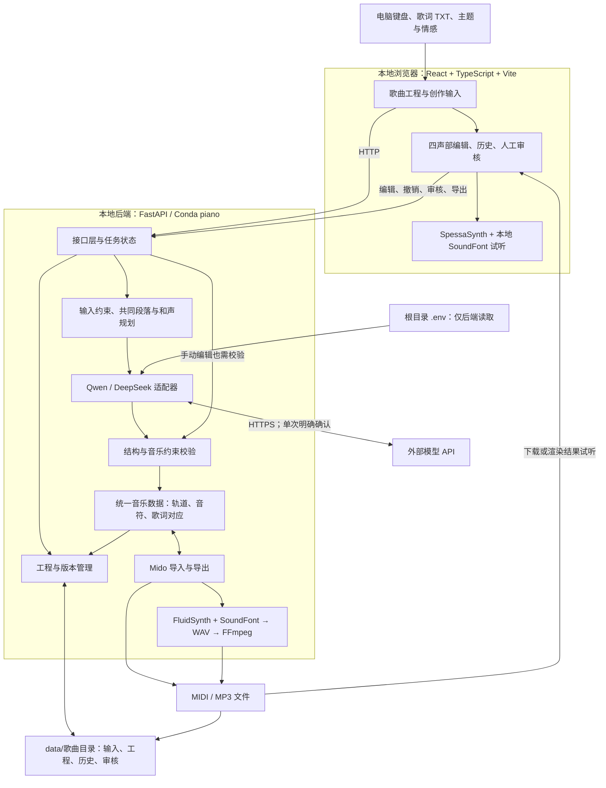

# 技术栈与项目架构建议

2026-10-14本地练习单元：`backend/resources/practice-units-v1.json`保存原创教材，`practice_units.py`确定性编译MIDI及记谱/目标；默认参数、实际谱与教材身份哈希一致才标标准单元。复用现有Mido、OSMD、PracticeStore与两轮判定，不增加依赖、服务或模型调用。选择后保存独立本地材料，重复选择复用同内容版本，教材变化建立新副本并保留旧记录；见[单元交付](practice-units-delivery-20261014.md)。

2026-10-13练习实现：React独立工作台，锁定OSMD 2.1.3/SVG与MusicXML；用语义对象的原小节/谱表/声部/时间/音高对应自有segment_id，并按和弦音头索引定位，不假设XML ID进入SVG。独立Mido解析、记谱整理、目标及PracticeStore已接入 `data/.practice/`，原歌曲Score保持原合同。输入纯状态机、AudioContext调度的预备/节拍、performance原事件评分、Python/JS同向量重放、IndexedDB待发送队列及幂等批次已实现。OSMD采用BSD-3-Clause，[完整许可](licenses/osmd-BSD-3-Clause.txt)随源码保留；新增76个前端依赖项，Python无新增依赖。练习工作台懒加载，OSMD导致约1.36MB压缩前分包，低性能设备体验需实测。实际启动、边界及证据见[交付](practice-delivery-20261013.md)。

2026-10-12乐句级离线实现：保持既有React/TypeScript、FastAPI/Pydantic/HTTPX、Mido与JSON保存，不增加依赖。新增独立 `lyric_phrases.py` 编译/校验、`lyric_group_edit.py` 原子草稿和 `phrase_tasks.py` 共享规划分块；v2用schema2，旧events/v1继续schema1。原有单请求合同保留，只有明确选择试验v2并确认输入/配置预算才允许新的多请求合同，最多17次/每次32768。C#宿主双读v1原行/v2音乐乐句协议，现成人声策略与模型不变；本轮纯结构检查，真实API及推理0次。默认入口、顺延边界、测试与下一轮预算见[本轮交付](lyric-phrases-delivery-20261012.md)。

2026-10-10实际人声接入：在 React/FastAPI/JSON/Mido/SoundFont 架构上增加 `backend/vocal-worker` 自有 .NET 10 无界面宿主，复用官方固定 OpenUtau 0.1.573-beta 的 Core/Builtin 和 ONNX Runtime DirectML 1.23.0。资源为完整绮萱 Qixuan v2.7.0 与2025.02 PC-NSF-HiFiGAN；项目内 .NET SDK 10.0.401 位于 `tools/vocals`，不改变 Conda piano，不加入 PyTorch/训练依赖。宿主处理汉字/拼音→音素时长→按谱演唱，FastAPI 独立队列以受控子进程调用，FFmpeg 完成独立干声、派生伴奏和混音；浏览器两条 WAV 在同一 AudioContext 起播。官方桌面软件并非后端 API，本项目协议是自建适配，固定版私有路径初始化仍是维护风险。详见[人声交付](vocal-delivery-20261010.md)，下文带旧日期的“人声未实现/待授权”保留历史语境。

2026-10-09当前状态与人声设计：有歌词已按[全文歌词重写](lyrics-rewrite-20261006.md)一次覆盖全文、按实际编配时长生成，不再先做60秒选段。下文第六阶段初始流程保留历史语境。人声仍未实现；用户确认初版仅非商业演示，助手推荐绮萱DiffSinger经OpenUtau外部验证，再评估独立C#工具复用其发音/渲染核心，现有React/FastAPI/Conda piano不变。不是现成桌面API，亦未批准新增.NET SDK或模型安装；官方来源、环境/许可风险、版本化媒体设计见[人声技术设计](vocal-synthesis-plan.md)。本轮仅只读调研及文档更新。

2026-10-06第六阶段更新：在原有React/FastAPI/JSON目录/Mido/SoundFont技术栈上接入审核后明确发起的整曲生成及整体修改，仍无数据库和合成人声。整曲引用短曲版本/不可变审核、全歌词及最多8音参考动机，采用32768输出上限；无歌词195秒，有歌词由模型安排61–600秒。旧文中“全曲尚未实现”是此前阶段状态，最新实现、验收和风险见[第六阶段交付](stage6.md)。新增真实模型请求0次，音乐效果未自动验收。

2026-10-05 阶段进展：正式前后端、JSON版本保存、MIDI编辑/交换、SoundFont试听与WAV/MP3已建立；第三阶段新增DeepSeek候选、歌词字词对应、整曲修改及版本审核，见 [第一阶段](stage1.md)、[第二阶段](stage2.md)、[第三阶段交付](stage3.md)。第四阶段增加程序固定的原演奏前缀、逐句主旋律试听及版本结构核对，见 [第四阶段](stage4.md)。第三阶段3次真实验收中2项结构/渲染通过、保留旋律失败；第四阶段没有新增真实请求，音乐质量与可唱性仍未验收。只有后端按需读取.env，Qwen、音乐工具、人声与全曲仍未实现。

初始设计日期：2026-10-04，当前状态更新：2026-10-05。本文保留目标架构与阶段实际选择。原设计轮只建立文档、依赖清单和配置模板；实现范围以阶段交付为准，有限真实调用已记录，稳定编曲质量仍未验证。

后续进展（同日）：已按用户指令建立 `frontend/prototype` 独立 HTML 交互原型，见 [原型说明](prototype.md)。以下架构仍是正式实现建议；浏览器原型的 localStorage 和简易合成音不能替代正式工程保存及音色渲染。

## 推荐方案与取舍

| 层次 | 优先推荐 | 职责与理由 |
| --- | --- | --- |
| 前端 | React + TypeScript + Vite、普通 CSS | 已实现中文工作台、表单与轨道控制；当前采用普通 CSS，CSS Modules 不作为已实现功能。本地工具无服务端渲染需求，暂不采用 Next.js。 |
| 状态与编辑 | React 状态与 ref、自建 SVG 钢琴卷帘 | 已实现音符增删、移动、时长及撤销，保存后由后端记录不可变版本。提供可键盘操作的参数表单；规模扩大后再评估 reducer/Context 与 Canvas。 |
| 即时演奏 | Web Audio + SpessaSynth + 本地 SF2 | 第二阶段使用 spessasynth_lib 4.3.14 / spessasynth_core 4.3.22，在 AudioWorklet 中读取同一本地 SoundFont；按键不经过后端，无简易合成音回退。 |
| 后端 | Python 3.12 / Conda piano + FastAPI + Uvicorn | 已实现本地API、歌曲工程、音频和候选任务；Pydantic校验，pydantic-settings只在后端按需读取MODEL_*，状态字段明确允许列表。 |
| MIDI | Python Mido；浏览器临时播放 MIDI | 后端负责权威导入、导出及事件检查，内部 480 PPQ。浏览器仅把已确定的事件转换为临时播放 MIDI，不将其当作工程文件或交换导出。深入乐理分析有需求后再评估 music21。 |
| 音频渲染 | FluidSynth + SoundFont → WAV → FFmpeg / MP3 | 使用现有 tools 程序；Python 以参数列表启动子进程并检查退出码，暂不引入 FluidSynth 动态库封装。 |
| 人声演唱 | 绮萱 + 配套声码器 + 固定 OpenUtau Core / 自建 C# 宿主 | 已实现普通话独唱，本地 ONNX CPU/DirectML；使用保存的实际音符、全文对应和速度图。Windows Job Object 保护取消/父进程退出，按句串行渲染；模型/词典/工具校验、版本和配置哈希、旧结果失效提示与独立媒体已接入。限非商业演示。 |
| 工程保存 | 每首歌的 JSON、版本快照与媒体文件 | 单用户本地先不用数据库；大量工程检索时再评估 SQLite。localStorage 不作为正式歌曲目录的替代。 |
| 模型调用 | HTTPX + DeepSeek适配器 | 旧events/v1每任务一次请求；试验v2明确预算，短篇一次、长篇共享规划后分块（至多17次）。均不自动重试、不重定向、不执行模型代码；Qwen只有对照设计，不自动切换，不加Agent框架。 |
| 验证 | pytest、Ruff、Node内置测试、Playwright | 已覆盖保存/编辑、MIDI、音色/音频、候选/歌词对应/版本审核及假HTTP故障；真实有限样例另行授权验收，可唱性与音乐质量仍需人工评估。 |

Vite 官方提供 React/TypeScript 模板，当前 Node 门槛为 20.19+、22.12+；本机会话验证的 Node 24.19.0 满足门槛，依赖组合仍需构建验证。[Vite](https://vite.dev/guide/)

第二阶段采用 SpessaSynth 的浏览器 AudioWorklet 与 SF2 播放能力，使用本地打包的工作线程代码；第一阶段的 Tone.js 简易合成音已从正式前端移除，独立原型不变。[SpessaSynth 浏览器文档](https://spessasus.github.io/spessasynth_lib/extra/working-with-browsers/)

FastAPI 的类型校验适合本项目 Python 数据处理后端；配置读取须显式实现。[FastAPI](https://fastapi.tiangolo.com/)、[配置管理](https://docs.pydantic.dev/latest/concepts/pydantic_settings/)

## 整体项目框架图

下图是目标设计，包含后续音乐工具和Qwen等模块。当前已有本地歌曲、录制编辑、MIDI、音色渲染，以及第三阶段的DeepSeek候选、歌词对应和版本审核；不逐项代表全部框图已经实现。



工程数据是权威来源，MIDI 是演奏交换格式，MP3 是声音结果；歌词对应、历史与审核不能只靠 MIDI 保存。

## 即时演奏与 MIDI 数据

按 KeyboardEvent.code 映射电脑按键；填写文本时不触发琴键，忽略自动重复；窗口失焦和停止时释放所有音符，切换音色也不能遗留旧音符。记录真实 note-on/note-off 和时间，原始演奏另存，不默认纠错或量化。回放由音频时钟调度，界面动画只显示进度。

浏览器需要用户点击启用音频。当前 SpessaSynth 与 FluidSynth 使用同一份经 SHA-256 检查的 SF2，分别提供快速试听与后端渲染结果试听。合成引擎、插值及设备仍可能造成差异，不承诺两者声音完全一致；最终 MP3 从可试听的渲染 WAV 编码。

统一数据建议包含 schema_version、revision_id、tempo_map、time_signatures、sections、tracks、lyrics_alignment。轨道保留 id、名称、角色、program、bank、channel、is_drum、音量；音符保留 id、pitch、velocity、start_tick、duration_tick。内部建议 480 PPQ，导入其他分辨率须转换，tick 与秒通过 tempo_map 换算；原始演奏时间另存避免舍入损失。

Mido 可读写轨道和事件，但不会自动提供编辑界面和乐器分类。[Mido](https://mido.readthedocs.io/en/stable/files/midi.html)

自产文件建议 Type 1 MIDI：独立速度/拍号轨及四个乐器轨，写入 program change、轨道名称与通道；GM 鼓采用第 10 通道（代码零基索引 9）及鼓音符映射。外部 MIDI 可能有混轨、变速、踏板和弯音；保留未编辑事件，对不能无损处理的内容明确提示，不擅自压成四轨。必须用实际文件验证往返。

## 任务、工程和审核

当前单后端进程、单编曲工作线程，最多2个运行/排队任务。POST创建任务返回ID，前端GET轮询；同步HTTPX在后台线程请求模型，另一个渲染队列启动受控工具子进程。状态落盘，重启遗留任务标为中断，不重发付费请求，不使用Redis/Celery。

模型以一次调用返回共同段落、和声和四声部。自然语言整曲修改读取当前60秒标准四声部及原约束，候选明确采用后产生可撤销版本。歌词按原行号/字词号到note_id列表对应，允许一字多音。第四阶段程序将原演奏按秒转480PPQ固定为前缀，容许1tick舍入，音高、力度、乐器/Bank不变，模型只在对应参考窗口后延展；记录过滤数量，错误对应仍拒绝。歌词试听通过完整速度图换算，直接逐句独听并跟随实际音频时间；审核重新核对当前乐谱并保存结构快照。自由改编利用、音乐表达和实际可唱性仍需人工评估。

AI短曲检查乐谱60秒(容差0.001)、发声覆盖和结尾，不能以末尾静音凑时长。渲染另加3秒尾音与最后50ms淡出，短曲WAV约63秒，MP3延迟检查不计入创作时长。审核绑定版本，新版本重新审核；第六阶段审核短曲通过只开放用户明确发起整曲，不自动调用。整曲检查自身目标时长和全歌词，音频同样加3秒尾音。结构/发声不等于音乐质量验收。

目标目录示意（不逐项代表当前文件；实际模块与数据布局见阶段交付文档）：

```text
piano_keyboard_create/
├── frontend/
│   ├── prototype/             # 独立页面原型，模拟功能显式标注
│   └── app/                   # 已建立正式前端
├── backend/app/
│   ├── api/                   # 工程、任务、导出接口
│   ├── schemas/               # 统一音乐数据与请求响应
│   ├── services/              # 编曲组织、校验、MIDI、渲染
│   ├── adapters/              # Qwen、DeepSeek；音频服务另设
│   └── storage/               # 目录隔离、原子写入、版本管理
├── data/歌曲目录/
│   ├── project.json           # 稳定工程 ID、显示名、当前版本
│   ├── inputs/                # 歌词、选段、原始演奏、创作要求
│   ├── revisions/             # 不可变音乐版本、指令和审核记录
│   ├── jobs/                  # 状态与脱敏调用记录
│   └── exports/               # 对应版本的 MIDI、WAV、MP3
├── tools/                     # 已有 FFmpeg、FluidSynth 与 SoundFont
├── scripts/                   # 启动与检查脚本
└── .env                       # 仅后端按需读取MODEL_*，不提交、不向前端暴露
```

当前以稳定歌曲 ID 隔离目录，显示名与 ID 分离，拒绝路径越界。单进程内锁定写入，文件原子替换；接口携带基础版本号，拒绝多标签页陈旧写入。采用显式手动保存，收到落盘确认才显示已保存；音频生成先保存，再绑定该版本。版本快照保留撤销来源，当前不自动保存。

开发时 Vite 代理 /api 到 127.0.0.1:8000，最终可由 FastAPI 提供前端构建文件以同源访问。仅绑定回环地址，限制主机/来源并校验写操作会话；前端不持有密钥，根目录 .env 不参与前端构建。

## AI 选择与验证边界

按用户选择，以 DeepSeek deepseek-flash + JSON Object 为主要接入路线，Qwen qwen3.8-max + JSON Schema 为可选对照，不自动切换，依据见 [模型接入](model-integration.md)。HTTPX 直接请求即可，暂不安装模型 SDK。首轮采用结构化输出减少工具循环复杂度，必要时再评估受限音乐工具；不让模型输出 Base64 MIDI，不执行模型生成的任意代码。

| 类别 | 状态与风险 |
| --- | --- |
| 本机会话已验证 | piano / Python 3.12.15、Node 24.19.0、npm 11.4.2 可用；FFmpeg 9.0.2、FluidSynth 2.6.1 可启动，存在 libmp3lame。 |
| 文件检查 | 已有 backend/app、frontend/app、npm 锁定文件与正式启动/检查脚本；Python 直接依赖版本已固定，全部传递依赖未全量锁定。 |
| SoundFont 已接入 | tools/soundfonts/GeneralUser-GS-main/GeneralUser-GS.sf2，随包文档为 2.0.3，实际 SF2 名称为 GeneralUser GS 2.0.3 BETA，解析到 287 个预设。四类乐器的浏览器发声、录制回放与 FluidSynth 渲染已有测试；版本、音质和许可边界见第二阶段文档。 |
| 交互风险 | 已验证浏览器音频解锁、四类发声、录制回放、加载失败恢复及导出试听；真实设备延迟、主观音质和大规模 SVG 编辑仍需人工体验。 |
| 最大产品风险 | 歌词可唱性、四声部配合、初始旋律利用及 60 秒结构；格式合法不等于音乐验收通过。 |
| 导出风险 | SoundFont 许可与音质、浏览器/导出音色差异、尾音与编码延迟、MIDI 往返和鼓语义。 |
| 保存风险 | 断电、任务中断、多标签页冲突、版本审核失效与歌曲隔离。 |

FluidSynth 可用 SoundFont 渲染 MIDI，FFmpeg 提供 MP3 编码；启动成功不能代替链路验证。[FluidSynth](https://www.fluidsynth.org/wiki/UserManual/)、[FFmpeg](https://www.ffmpeg.org/ffmpeg-codecs.html)

实施顺序：独立原型 → 无 AI 的录制/编辑/工程/MIDI 往返 → 本地音色与 WAV/MP3 渲染 → DeepSeek短曲候选与有限真实检验 → 程序保留原演奏、逐句试唱与60秒验收。前四阶段已分别获用户授权，第四阶段未包含新付费预算；后续阶段与开发助手真实付费复验等待单独授权，不因资源、依赖或审核通过自动推进。
