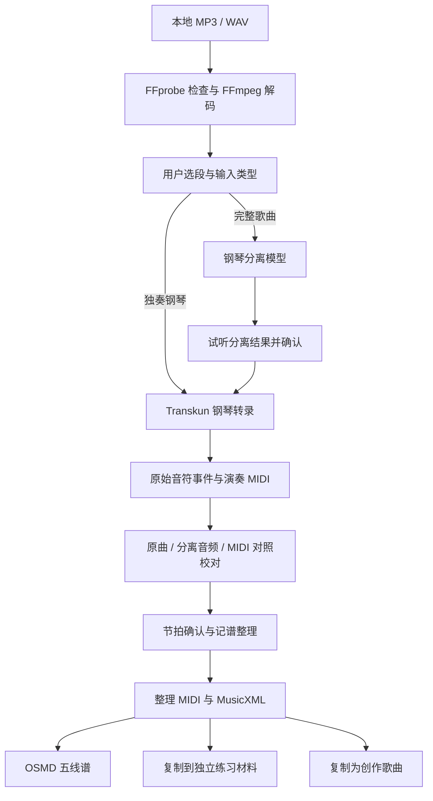

# v2— 乐曲键盘扒谱

文档性质：功能与技术设计；编写日期：2026-10-27。

本轮授权为调研与文档整理。本文描述待实施方案，模型名称为选型建议；安装、模型下载、真实推理和功能开发在明确启动后开展。“v3”是本次产品迭代名称，与现有 `lyric-phrases-v2` 合同、歌曲 schema 和演唱协议分别管理。

## 1. 目标与产品定位

让用户从本地 MP3、WAV 中提取钢琴或钢琴音色键盘的演奏信息，经过试听校对，保存 MIDI、显示五线谱，并进入 NeoNote 的练习或创作流程。

核心路径：**上传音频 → 选择片段 → 提取键盘 → 校对音符 → 整理成谱 → 保存／练习／继续创作**。

用户确认的目标：

- 从包含键盘的乐曲中扒出键盘声部。
- 支持本地音频输入，以 MP3、WAV 为起点。
- 结果可以显示为五线谱，或保存为本地 MIDI。
- 与已有新手练习、音乐创作能力连接。

本方案建议先支持钢琴独奏和混音中可辨识的钢琴，再用电钢琴等材料评估覆盖范围。电子键盘可演奏多种音色，钢琴模型的识别范围不等于全部键盘音色。

### 1.1 三种任务分别处理

| 任务 | 输入与结果 | 本轮定位 |
| --- | --- | --- |
| 独奏转录 | 钢琴录音 → 音符事件／MIDI | 建立基础转录能力 |
| 混音键盘扒谱 | 完整歌曲 → 键盘分离音频 → 键盘 MIDI | 核心业务目标，独立验证分离效果 |
| 简单改编 | 已确认的旋律 → 新增和弦／伴奏 | 后续扩展，结果另存为创作作品 |

扒谱保留听到的演奏；简化练习、补伴奏和风格变化均作为派生操作，由用户明确选择。原曲中键盘可能主要演奏和弦而非主旋律，转录不能默认将人声旋律归为键盘。

## 2. 推荐技术路线



主推荐：Transkun 作为钢琴转录候选；混音分离采用可替换适配器，以 `htdemucs_6s` 作对照基线，通过 `python-audio-separator` 评估其他明确输出钢琴声部的权重。钢琴分离的正式默认模型在样例比较后确定，不以“支持六声部”代替效果验收。

记谱优先复用现有 MusicXML／OSMD 流程，补充音频转录的时间校准与声部整理。LLM 不承担音频音高检测；后续可用于解释修改要求和规划伴奏，实际音符仍经程序校验。

## 3. 技术栈与工具

| 层次 | 建议工具 | 职责与接入方式 |
| --- | --- | --- |
| 页面 | 现有 React / TypeScript / Vite | 上传、波形选段、任务状态、校对、五线谱与导出 |
| 音频预处理 | 现有 FFmpeg / FFprobe | 检查实际媒体格式、解码、裁剪、按模型要求重采样 |
| 分离 | python-audio-separator；Demucs 六声部基线 | 输出钢琴 WAV；适配器显式记录模型与目标声部 |
| 钢琴转录 | Transkun V2 候选 | 识别音高、起止时间及力度，生成事件与 MIDI |
| 对照转录 | piano_transcription_inference | 用同样片段比较错音、漏音、时值及运行成本 |
| 运行时 | PyTorch；具体版本待兼容检查 | CPU 基线与可选 CUDA 加速，不预先承诺显存或耗时 |
| 后端 | 现有 FastAPI / Pydantic | 文件与参数验证、任务管理、不可变结果和导出 |
| MIDI | 现有 Mido | 保留原始事件，生成兼容 MIDI 与时间映射 |
| 记谱 | 现有 practice_notation + MusicXML | 整理拍点、小节、声部、休止和延音；扩展部分单独测试 |
| 五线谱 | 现有 OpenSheetMusicDisplay | 渲染、音符高亮、谱面定位；识别与量化由后端负责 |
| 试听 | HTML 音频 / Web Audio；现有 SpessaSynth | 原曲、分离音频与 MIDI 切换，循环指定片段 |
| 存储 | 独立 TranscriptionStore（拟新增） | 保存输入、任务、原始结果、修订和导出 |

Python 继续使用 Conda `piano`。新增依赖先检查 Python 3.12、现有 NumPy、PyTorch、ONNX Runtime 和 GPU 驱动兼容性。不能为满足旧项目要求直接降级现有环境；若确需独立运行环境，提出原因与替代方案后另行确认。

建议模型顺序运行并限制并发，避免分离与转录同时占用显存。CPU/GPU 切换要在结果中记录；OOM 显示原因，由用户选择缩短片段或更换运行方式，不默默重复完整任务。

## 4. 开源项目取舍与依据

以下为仓库公开说明与本项目判断，非本机效果测试。

| 项目 | 已知能力 | 本项目建议 |
| --- | --- | --- |
| [Transkun](https://github.com/Yujia-Yan/Transkun) | 钢琴音频到 MIDI，CLI 支持 CUDA；V2 使用 Transformer 与半马尔可夫事件解码 | 首选转录候选，固定代码版本及权重后测试 |
| [piano_transcription_inference](https://github.com/qiuqiangkong/piano_transcription_inference) | 钢琴与踏板转录，CPU/CUDA 接口；README 标注 Windows 未测试 | 对照基线，优先检查 Windows/Python 兼容 |
| [Basic Pitch](https://github.com/spotify/basic-pitch) | 轻量多音转录，官方说明单一乐器输入最佳 | 简单旋律／不同音色的备选，不作混音钢琴分离器 |
| [Demucs](https://github.com/facebookresearch/demucs) | `htdemucs_6s` 包含钢琴；官方指出钢琴串音和伪影，原库已归档 | 分离基线，不直接指定为正式默认 |
| [python-audio-separator](https://github.com/nomadkaraoke/python-audio-separator) | 多种分离模型的 CLI/Python 包装 | 统一调用入口；每个具体权重另核目标声部、来源与许可 |
| [YourMT3+](https://github.com/mimbres/YourMT3) | 多乐器转录；官方链接到预发布代码与演示 | 后续比较直接多轨转录路线，首版避免同时引入两套主流程 |
| [Muse](https://github.com/mqtik/muse) | README 组合分离、Transkun、PM2S，并区分演奏与乐谱 MIDI | 借鉴处理步骤和对照试听，不照搬自动建环境／下载行为 |
| [PM2S](https://github.com/cheriell/PM2S) | 演奏 MIDI 转乐谱研究实现 | 记谱升级候选，老版 Python/PyTorch 依赖需适配 |
| [MIDI2ScoreTransformer](https://github.com/TimFelixBeyer/MIDI2ScoreTransformer) | 演奏 MIDI 转乐谱，依赖 MuseScore 与定制包 | 作为研究备选，不加入首版必需依赖 |
| [AccoMontage](https://github.com/zhaojw1998/AccoMontage) / [AccoMontage2](https://github.com/billyblu2000/AccoMontage2) | 主旋律／和弦到钢琴伴奏；第二版包含和声生成 | 参考简单编配，另存结果，不作为扒谱替代 |

来源核对日期：2026-10-27；其余项目沿用本对话前一轮官方仓库调研。实施前固定 commit、发行版本和权重 SHA-256，并逐项复核许可证。代码许可证、模型权重和训练／示例数据条款分别记录；仓库可访问不等于所有资产可任意再分发。

## 5. 处理方法与理论

### 5.1 音源分离

混音可近似写为 `x(t) = piano(t) + other(t)`。分离模型估计钢琴波形，输出仍可能混入其他乐器或丢失钢琴弱音。人声去除得到的是伴奏整体，并不等于钢琴独立轨。

独奏模式直接转录；混音模式分离后先让用户试听。保存裁剪偏移、采样率和模型引入的延迟，保证分离音频与原曲在同一时间位置对照。暂不自动串联多次降噪／去混响，以免改变起音和延音。

### 5.2 自动音乐转录

转录结果表达为事件 `n = (pitch, onset_seconds, offset_seconds, velocity)`。和弦允许多个音同时存在；连续重复的同音需要保留独立起音。

Transkun 的方法是给候选音符时间区间评分，再用半马尔可夫结构解码事件，并估计力度与精细边界。该方法适合产出演奏时间事件，而非直接确定完整的谱面排版。[官方方法说明](https://github.com/Yujia-Yan/Transkun)

模型权重可能采用不同的踏板时长标注约定；所选权重必须记录“按键结束”还是“踏板延长后结束”的含义。不能把所有长尾都当成长按键，也不能从没有踏板预测的模型虚构踏板控制。

### 5.3 时间轴与 MIDI

原始事件始终以秒保存。裁剪片段内时间与原文件时间满足：`source_seconds = clip_start_seconds + local_seconds`，另记录已校正的模型／解码偏移。

演奏 MIDI 可使用明确标注的技术速度来保持秒级时间；该速度不是识别出的曲速。整理谱面时另确认 BPM 与首拍位置，建立秒到拍的映射。恒速情况下：`beats = (seconds - first_beat_seconds) × BPM / 60`；变速采用分段积分和对应速度图。

小节起点与 BPM 同样重要。允许首拍位于片段开始之前以表达弱起；不把第一声自动当作强拍。转换为现有 480 PPQ 时记录舍入，保证所有音符时长为正且顺序正确。

### 5.4 从演奏到五线谱

1. 估计并让用户确认速度、拍号、第一强拍及弱起。
2. 将起止位置整理到候选节奏网格，展示修改前后的偏差。
3. 基于同时发声、旋律连续性和声部交叠划分声部，左右手仅作为可调整建议。
4. 按调号与上下文处理升降号，生成小节、休止符、连梁及跨小节延音线。
5. 保留同音重复起音；延音线仅连接一个持续音拆出的同音片段。
6. 圆滑线表达乐句连贯，音频缺少明确依据时不自动宣称恢复原谱标记。

“中央 C 以上全归右手”不能覆盖交叉手和内声部。首版可提供手动分配／拆分，并明确复杂谱面的整理限制。三连音、自由速度或复杂多声部超出整理能力时，仍保留原始 MIDI，提示用户调整片段或参数。

### 5.5 校对与原始结果保护

- 原始转录保留；删音、补音、修改音高／时长另存修订。
- 对低力度孤立音、异常短音、大跳和密集重叠可给规则提示，由用户决定修正。
- 模型若未输出可解释的置信分数，字段为空；规则提示不能伪装成模型概率。
- 和声纠错、音阶吸附、自动补全不默认作用于扒谱结果，避免把真实演奏改成“看起来合理”的谱。

## 6. 业务流程与页面

建议保留顶部练习／创作入口，在两者提供“从音频扒谱”入口，打开同一工作区。是否升级为第三个顶层入口属于后续交互决定。

| 步骤 | 用户操作 | 平台输出 |
| --- | --- | --- |
| 导入 | 选择本地 MP3/WAV | 文件名、时长、声道、波形、格式错误 |
| 选段 | 选择时间范围，指定独奏／完整歌曲 | 片段预览与预计处理步骤 |
| 分离 | 混音时启动分离并试听 | 钢琴分离音频；可接受、换参数重试或停止 |
| 转录 | 启动钢琴转录 | 原始音符与 MIDI；任务进度／失败原因 |
| 校对 | 对照原曲、分离音频、MIDI，循环片段 | 音符修订版本和修改记录 |
| 整理 | 确认曲速、拍号、起拍与量化 | 五线谱、节拍映射及整理变更说明 |
| 导出 | 下载 MIDI／MusicXML | 与当前修订绑定的完整文件 |
| 使用 | 送入练习或复制为创作歌曲 | 独立目标材料，保留扒谱来源关系 |

建议提供原曲、分离键盘、MIDI 三种切换试听，使用共同的片段时间定位。后台状态显示阶段与已处理片段；没有可靠总量时显示不定进度，不编造百分比。

五线谱可以全曲预览，但进入练习仍按现有 1–16 小节选段及键位可达性检查。展示完整钢琴音域和是否能用电脑键盘练习是两件事；不为适应键位静默移调或删音。独立“简化练习副本”可后续设计。

## 7. 数据与结果格式（拟议）

建议新增 `data/.transcriptions/<稳定ID>/`，与歌曲、练习分开；此路径属于设计，尚未创建运行数据。

```text
data/.transcriptions/<id>/
├─ project.json             # 名称、当前修订、来源哈希
├─ source/                  # 上传原文件
├─ jobs/<job-id>/            # 参数、状态、模型指纹、受控日志
├─ results/<result-id>/      # 解码片段、分离音频、原始事件/MIDI
├─ revisions/<revision-id>/  # 校对事件、节拍映射、记谱结构
└─ exports/<revision-id>/    # 整理MIDI、MusicXML及导出清单
```

核心事件字段建议：

```json
{
  "schema": "neonote-transcription-events-v1",
  "time_basis": "clip_seconds",
  "clip_start_seconds": 30.0,
  "notes": [
    {"id": "n1", "pitch": 60, "onset_seconds": 0.5,
     "offset_seconds": 1.2, "velocity": 80, "confidence": null}
  ]
}
```

结果还需保存输入 SHA-256、片段边界、采样率、模型版本与权重哈希、参数、执行设备、耗时和时间偏移。修订关联父版本和原音符 ID；拍号、调号、左右手等区分推断与用户确认。

输出分为：

- `performance.mid`：原始转录时间；支持的踏板事件独立保留。
- `score.mid`：用户确认后的节拍与音符，用于练习／编辑。
- `score.musicxml`：五线谱语义与结构，OSMD 展示并可下载。

复制到创作时使用兼容现有导入规则的整理 MIDI；踏板等不支持事件由用户明确选择转换策略，原始结果不丢弃。复制到练习时保存完整来源快照和哈希，原扒谱后续修改不改写已有练习记录。PDF 打印作为后续选项。

## 8. 接口与模块建议

| 模块 | 拟议职责 |
| --- | --- |
| transcription_api | 上传、选段、创建任务、查询、取消、修订与下载 |
| transcription_store | 独立目录、不可变结果、版本冲突与原子发布 |
| transcription_audio | 媒体探测、解码、时间偏移和有界裁剪 |
| transcription_models | 分离与转录适配器；模型清单及资源就绪检查 |
| transcription_notation | 转录事件到记谱数据，复用／抽取现有整理逻辑 |
| TranscriptionWorkspace | 波形、状态、对照试听、音符校对、谱面和导出 |

接口可采用 `/api/transcriptions` 下的 `jobs`、`revisions`、`exports` 子资源。所有写操作沿用本地会话与基础版本检查，返回服务端生成的 ID，不接受任意磁盘输出路径。

初期推荐后端管理独立本地推理子进程，通过结构化任务文件传参和返回结果；仍由 `conda run -n piano` 启动。接口导入和应用启动不自动下载模型。模型资源建议放在 `tools/transcription/`，安装说明与无密钥资源清单随源码，权重与大文件忽略提交。

## 9. 任务、资源与失败处理

任务状态建议：`queued → preparing → separating（可选）→ awaiting_review（混音）→ transcribing → validating → succeeded`，另有 `failed / cancelling / cancelled / interrupted`。记谱修订单独保存，转录成功不代表用户已确认乐谱。

- 首版建议一个重型推理任务并发；与现有歌声任务共享 GPU 使用限制。
- 取消时终止并回收整个子进程树，确认退出后释放锁；Windows 文件句柄关闭后才能移动资源。
- 重启后未完成任务标为中断，显式重试产生新尝试，不自动重新推理。
- 中间文件先写临时位置；校验完成才发布结果，不提供半成品下载。
- 缓存键包含输入、选段、模型／权重／参数／处理版本，重跑前检查缓存完整性。
- 校验实际媒体而非仅扩展名；限制解码后的时长、声道、采样数、磁盘空间和子进程耗时。
- 失败保留安全诊断，不覆盖旧结果；跨版本编辑返回冲突。
- 首版先不提供扒谱工程删除入口；后续如开放，需独立回收站、活动任务保护及整工程恢复，不能直接复用歌曲删除路径。

建议试验上限：上传 100 MiB／10 分钟，单次选段不超过 60 秒；第一轮效果测试使用 15–30 秒。以上是待确认工程限额，需以解码与推理资源测试调整。进入既有创作仍遵守其 10 分钟／5000 音符及导入限制。

## 10. 简单旋律编配的扩展

先完成并确认扒谱，再提供“以此旋律创建伴奏”操作。新作品保留来源修订，原始转录继续可访问。

优先建议规则编配：用户选定旋律声部，选择和弦进行与柱式／分解伴奏，设置疏密、音域和难度。和弦可由程序或 LLM 给候选，用户确认后展开为音符；原旋律锁定，伴奏另轨。

理论上通过调性、重拍音与持续音约束和弦候选，用相邻和弦的声部移动控制伴奏跳进，再按固定节奏型展开。这是创作策略，不代表恢复原曲伴奏。双手复调转录不能直接当作单声部主旋律输入，需要用户选择或修订。

[AccoMontage](https://github.com/zhaojw1998/AccoMontage) 与 [AccoMontage2](https://github.com/billyblu2000/AccoMontage2) 可供后续比较乐句组织和伴奏生成；本次不增加模型依赖或沿用历史 API 调用预算。

## 11. 分阶段实施与验收

| 阶段 | 交付 | 进入下一阶段的依据 |
| --- | --- | --- |
| P0 兼容与资源核对 | 固定候选版本、许可、权重来源、环境方案 | 与 piano 共存方案可行，依赖及下载范围明确 |
| P1 独奏转录 | 上传／选段／任务／原始 MIDI／对照试听 | 同一批短片段完成真实转录，音符、耗时及错误统计可复核 |
| P2 混音键盘 | 分离与试听确认，接入同一转录链路 | 分离＋转录较直接转录的收益、损失与适用材料明确 |
| P3 整理与联动 | 校对、MusicXML、五线谱、练习／创作复制 | 保存重开、显示、导出往返和数据隔离通过；谱面人工检查 |
| P4 扩展 | 长音频、电钢琴、多轨对照或简单编配 | 单独确定优先级和验收，前三阶段不自动授权 |

完整 v3 核心交付包含 P1–P3；仅独奏转录通过不能宣布完成“混音提取键盘”的目标。

### 11.1 固定评估材料

建议至少准备四类、每类三个 15–30 秒片段：纯钢琴、钢琴＋人声、钢琴＋完整乐队、电钢琴。记录材料来源、哈希、声部和选择原因。

已有 MIDI 可渲染为可控音频，再加入已知伴奏构造混音；此类材料有参考音符与干净钢琴轨。另选真实录音人工标注，以区分合成音色测试与真实歌曲泛化。

### 11.2 指标与验收口径

| 层次 | 检查内容 |
| --- | --- |
| 分离 | 有干净参考轨时计算分离指标；同时人工听键盘保留、其他乐器串入、瞬态和尾音损伤 |
| 转录 | 音高＋起音 Precision/Recall/F1，结束时间误差、漏音、重复音与和弦完整性 |
| 记谱 | 拍号／首拍确认、时值可读性、小节时长、休止与延音线、左右手修正量 |
| 交互 | 原音频与 MIDI 定位一致，校对可撤销，保存重开和导出版本对应 |
| 资源 | 总耗时、每音频秒耗时、峰值显存／内存、失败类型与取消回收 |
| 联动 | 练习可达性与原记录不变，创作生成新歌曲且保留来源 |

建议固定音符匹配口径：音高相同、起音误差不超过 50 ms；结束容差取 50 ms 与参考时长 20% 的较大者。分别报告只看起音与包含结束的成绩，采用一对一匹配，踏板标注约定一致。参考标注和容差应在比较模型前冻结。

质量阈值在 P1 基线评估后由用户确认，按独奏／混音分别设定；先报告结果和修正工作量，不将某数据集公开 F1 当作 NeoNote 实际准确率。确定阈值前不切为默认稳定功能。软件检查与人工听谱检查各有独立记录。

## 12. 下一步需要确定的事项

- 确认先执行 P0/P1，还是一并授权 P2/P3；本次文档不代表实施授权。
- 确认试验文件／片段限额与准备的评估材料。
- 通过 P0 后确定分离候选权重、安装下载清单与可用 CPU/GPU 路径。
- 基线测试后确认可接受的错误率、人工修正量及等待时间。

其余常规设计沿用本文建议推进，不重复确认本地 MP3/WAV、键盘声部目标、MIDI／五线谱输出等既定方向。

## 13. 相关项目文档

- [项目首页](../README.md)
- [现有技术架构](technical-stack.md)
- [练习设计](practice-design-20261013.md)与[练习交付](practice-delivery-20261013.md)
- [本地基础练习单元](practice-units-delivery-20261014.md)
- [MIDI 与音频渲染](stage2.md)
- [乐句谱曲设计](lyric-phrases-plan-20261012.md)

本文完成时仅进行公开资料核对、代码只读核对和文档修改；没有安装依赖、下载权重、运行转录／歌声推理或调用付费 API，也没有访问真实 `.env`。
