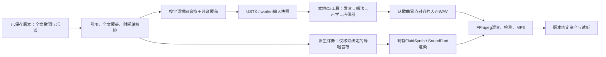

# 人声演唱：技术选型与设计

## 2026-10-12乐句表达离线适配

用户选择lyric-phrases-v2后，本轮已实现乐句合同、字组编辑及长文任务，并增加 `neonote-vocal-v2`：从保存版本实际note_id绑定按音乐乐句建part，保留完整速度图、绝对tick和首音歌词/后续`+`。v1继续按原行读取。协议、歌词身份、乐句布局和固定唱法策略纳入哈希；旧读音防错及旧资产版本提示沿用原有保存链路。

C#宿主新增字组/音符/音素/合成片段来源映射诊断，已重新编译；纯 `--validate-request` 接受8份合法v1/v2输入并拒绝3份非法输入，未初始化歌手或执行推理。继续关闭音高预测、颤音和邻近片段合并；派生伴奏只移除绑定导唱。真实模型请求及真实歌声推理均0次。元音衔接、重音、按行/乐句对照与长文耗时列入下一轮明确启动的验证。入口、资源指纹、证据和提案见[本轮交付](lyric-phrases-delivery-20261012.md)，设计门槛见[乐句级方案](lyric-phrases-plan-20261012.md)。下述2026-10-10真实材料保持原记录。

## 2026-10-10实际交付（优先于历史设计）

用户本轮授权现成普通话歌手演唱、官方资源下载、SDK、独立无界面工具和平台接入。已采用绮萱 Qixuan v2.7.0、2025.02社区声码器、OpenUtau 0.1.573-beta 官方构建的 Core/Builtin DLL，自建 .NET 10 控制台宿主，不操纵桌面窗口。按真实 note_id 转换全文、完整速度图、一字多音续唱；派生伴奏只移除绑定导唱，原谱保留。FastAPI 已接入资源检查、配置冲突、任务/取消/中断、独立文件与歌曲回收站；保存与导出页已有歌手/读音/音量/三种试听/下载。

先完成独立 Core 宿主三句真实小样，再通过隔离 FastAPI 完成三句、变速、CPU、110秒/171字词历史谱和1024字词固定谱的真实音频链路。人声在本地 ONNX Runtime 中推理，未增加 Python 包；付费 API 请求0次，未读取、修改或展示真实 `.env`。软件结果与人工听感分别记录，桌面编辑器逐点对照仍待人工。来源、许可、实际目录、命令、检查证据和人工标准见[2026-10-10人声交付](vocal-delivery-20261010.md)。

同日修复演唱设置422：配置保存独立于乐谱是否可唱，当前保存版本的演唱检查随配置接口只读返回。混合英文作品可以保存合法配置，界面列出未支持字词并阻止无效生成；真正发起任务时仍严格检查全文、真实音符和普通话范围。拼音读音修正限用于汉字，英文音节适配仍按下文单独设计，不自动删词、替换歌词或重作曲。

下文2026-10-09及2026-10-08内容保留当时的设计状态与备选讨论；“待授权/尚未实现/估计工作量”属于历史，不覆盖以上本轮授权和实测。自定义音色、训练、RVC、人声外部 WAV 导回和商业用途不在本轮交付范围。

## 2026-10-09历史选型结论

本轮仅调研、设计和文档更新，未开发、安装、下载模型、启动服务、训练或调用付费接口；未打开、修改或展示真实 `.env`。用户已确认：**初版只做非商业演唱演示，不覆盖商业用途**。以下为助手推荐，尚不是实施授权。

**主推荐：绮萱 Qixuan v2.7.0 中文 DiffSinger 音源 + 配套2025.02社区声码器；先在OpenUtau验证三句演唱，再用复用OpenUtau核心的独立C#渲染工具接入NeoNote。** 保留React/FastAPI/Conda piano和歌曲JSON目录，不引入新的Python环境、不训练声库、不重新调用DeepSeek作曲。

选择依据是可使用现有音符和歌词、官方发布完整音源、允许开发推理程序、Windows可用CPU/DirectML，以及能复用现成中文发音与音素时长处理。并非已经证明音质最好或一键接入最省时。第一道门槛是外部听感，第二道门槛是无界面渲染可行性，两者分别验收。

必要备选：若核心拆分成本过高，先交付“导出演唱工程→OpenUtau导出WAV→NeoNote导回合听”的过渡流程；若中文听感不符合需求，再比较 **Synthesizer V Studio 2 Pro + Mo Xu** 的外部制作结果。商业软件不作为已获得授权的后台引擎，暂不采购。

## 已实现基础与本机事实

本轮只读核对代码，不重跑历史测试。历史通过数属于交付记录，不是本轮新增验收。

| 项目 | 当前证据与影响 |
| --- | --- |
| 全文谱曲 | `backend/app/lyric_composition.py` 的 `arrange_lyrics` 建立全文音符与对应；当前64非空行/1024字词、10分钟/5000音符。有歌词不再先做60秒选段。 |
| 演唱输入 | `models.py` 的 `Composition.melody_track_id`、`LyricUnit(line_index, unit_index, text, note_ids)` 已存在，每字词可引用1–12个音符；`Note`有音高、起点、时长、力度，**没有**发音、音素或音符角色字段。 |
| 校验 | `composition.py::validate_alignment`检查引用、重复分配、顺序、主旋律单音、48–84音域、0.12–5秒音符及行间换气。这不是任何歌手的舒适音域保证，也不是发音处理。 |
| 时间轴 | `Score.ppq=480`，`Score.seconds_at`按完整速度图换算；跨速度点音符必须用结束秒减开始秒。不能只用首个BPM换算全曲。 |
| 现有音频 | `render.py::RenderManager`绑定不可变revision，用FluidSynth/FFmpeg生成44.1kHz、双声道WAV及192kbps MP3，时间轴加3秒尾音、末50ms淡出；现在只有mix/full模式，没有演唱合成、歌词音符过滤或人声导入。 |
| 版本与删除 | `storage.py::_commit`保存输入与新版本，更新project指针；有基础版本冲突检查、原子写入、整首回收站。新演唱资产应留在歌曲目录内，纳入活动任务删除保护。 |
| 操作系统/CPU | 当前Windows工作区；CIM返回AMD Ryzen 7 H 260 w/ Radeon 780M Graphics，8核16线程。 |
| 内存/GPU | 内存33,568,071,680字节，约31.3GiB；`nvidia-smi`返回RTX 5060 Laptop GPU、8151MiB显存、驱动610.88。具备尝试本地推理的基础，未测实际空闲显存、吞吐或音质。 |
| 磁盘 | 检查时D盘空闲104,624,848,896字节，约97.4GiB；不等于已核验声库解压与缓存占用。 |
| Python | `conda run -n piano`返回Python3.12.15；包元数据中未发现torch、numpy或ONNX Runtime。未导入应用或加载MODEL配置。 |
| .NET | 可用.NET 10.0.11运行时，`dotnet --list-sdks`没有SDK条目。编译辅助工具仍需后续授权安装匹配SDK；有运行时不等于能编译。 |

代码入口：[数据模型](../backend/app/models.py)、[歌词编配](../backend/app/lyric_composition.py)、[对应校验](../backend/app/composition.py)、[歌词MIDI元数据](../backend/app/song_metadata.py)、[音频任务](../backend/app/render.py)、[工程保存](../backend/app/storage.py)。

## 候选比较与可调用边界

| 路线 | 已查官方能力 | 对首版的取舍 |
| --- | --- | --- |
| OpenUtau桌面 + 中文DiffSinger | MIDI导入、发音器、WAV导出；默认CPU，Windows可选DirectML独显。 | 最先验证听感，不改变piano。要手动安装资源、校对歌词、导出；桌面不是HTTP服务。[官方入门](https://www.openutau.com/Getting-Started/)、[DiffSinger支持](https://www.openutau.com/DiffSinger-support/) |
| 复用OpenUtau核心的C#工具 | 源码有`DiffSingerRenderer.Render`和`LoadRenderedPitch`，RenderResult包含采样及位置；使用ONNX Runtime推理。 | **平台接入主推荐**：复用发音、唱法、声学、声码器链路，但须自己做无界面宿主、任务协议与生命周期管理。[渲染源码](https://github.com/openutau/OpenUtau/blob/master/OpenUtau.Core/DiffSinger/DiffSingerRenderer.cs) |
| piano内自行实现ONNX适配 | 可用ONNX Runtime库载入模型；并不自动理解歌词/MIDI。 | 技术后备。需重建发音器、音素时长、F0、唱法参数及模型张量适配，与OpenUtau对照成本较高，不与主路线同时开发。 |
| OpenVPI Python推理脚本 | 官方有`python scripts/infer.py variance ... --exp ...`与`acoustic ... --exp ...`，输入DS文件与实验checkpoint配置。 | **不能把OpenUtau ONNX声库直接当checkpoint使用**。不用训练仓库整套依赖替换现有环境。[官方流程](https://github.com/openvpi/DiffSinger/blob/main/docs/GettingStarted.md)、[脚本](https://github.com/openvpi/DiffSinger/blob/main/scripts/infer.py) |
| DiffScope/dsinfer | 官方低层C++库覆盖时长、音高、唱法、声学、声码器推理，需CMake/原生依赖。 | 尚不是NeoNote可直接调用的歌词→WAV服务；需声库与发音适配，首轮不引入第三条开发栈。[维护者仓库](https://github.com/diffscope/dsinfer) |
| Synthesizer V Studio 2 Pro + Mo Xu | 官方中文原生女声音库，可在编辑器按音符/歌词演唱、导出独立WAV；有编辑器内JS/Lua脚本。 | 中文听感对照/外部制作备选，需购买授权；未查得可据此使用的公开无界面后端API授权。脚本API不等于可嵌入服务。[产品](https://store.dreamtonics.com/product/synthesizer-v-studio-2-pro/)、[脚本](https://resource.dreamtonics.com/scripting/)、[导出](https://sv2.docs.dreamtonics.com/en/render) |

标准TTS、GPT-SoVITS或RVC不作为本次按谱演唱主路线：前者标准接口不是音符时值控制器，后者先需要演唱源音频。云端服务仅在能提供指定乐谱输入、独立人声、时间轴约束及许可证据时重新纳入；本轮没有核实到应替换主路线的此类服务，不以“歌词生成歌曲”接口代替。参考：[GPT-SoVITS接口](https://github.com/RVC-Boss/GPT-SoVITS/blob/main/api_v2.py)、[RVC项目](https://github.com/RVC-Project/Retrieval-based-Voice-Conversion-WebUI)。

### 两种落地方式与工作量

以下为一名熟悉本项目开发者的粗估，非性能实测或工期承诺；模型下载时间、授权沟通和人工反复调音另计。

**最快听到效果：外部验证，约0.5–2人日。** 后续获授权后安装OpenUtau和指定声库/声码器；用现有导出MIDI选主旋律，依据版本JSON人工核对三句歌词和延音；导入同起点伴奏，输出从歌曲0秒开始、无混响的独立人声WAV。现有MIDI歌词标记只落在字词首音符，不能假设导入会恢复一字多音。首轮可人工完成，不必先开发导出器。

**过渡式平台流程：约3–6人日。** 新增USTX导出、伴奏派生、独立WAV导回与来源确认、混音和版本绑定；这些目前都未实现。外部若改了音高、速度、音符位置，应标记“外部编辑结果”，重新对齐核验，不能冒充原谱直出。

**平台内一键：约15–30人日，其中先用2–4人日验证无界面宿主。** 固定经过外部验收的OpenUtau提交与依赖，复用中文发音和DiffSinger核心，建立自有C#控制台程序；Python仍在piano中，以参数数组启动隐藏子进程，传入任务JSON，接收进度和WAV/报告。一次只运行一个GPU任务，按乐句处理。随后完成资源检查、取消/超时、读音修正、版本保存、试听和混音。若无法可靠脱离GUI，停止该分支并采用过渡流程，不用鼠标自动点窗口伪装后端。

核对到的`Program.cs`启动Avalonia桌面生命周期；`RenderEngine`不是公共稳定SDK，仍涉及DocManager、调度器、SingerManager、全局偏好和缓存。必须隔离路径与状态、等待发音完成、锁定代码版本，不是只调用一个Render函数。下述`vocal-worker --request ... --output ...`是**待开发协议示意，非OpenUtau官方命令**。[桌面入口](https://github.com/openutau/OpenUtau/blob/master/OpenUtau/Program.cs)、[渲染组织](https://github.com/openutau/OpenUtau/blob/master/OpenUtau.Core/Render/RenderEngine.cs)。

### 环境与性能风险

- OpenUtau官方支持Windows DirectML；选择RTX独显而非集显，CPU可作明确标示的兼容测试。先测冷启动、逐句峰值显存和整曲时间，不承诺实时、固定倍速或8GB一定够用。
- 本轮查看的上游Core项目目标为`net10.0`，Windows固定ONNX Runtime DirectML 1.23.0，并在源码注释中记录1.24.x原生崩溃风险。这是上游记录，不是本机复现；后续固定实际测试提交，不能一律升级最新包。[项目依赖](https://github.com/openutau/OpenUtau/blob/master/OpenUtau.Core/OpenUtau.Core.csproj)
- Microsoft说明DirectML处于维护阶段，新功能转向WinML。首轮沿用OpenUtau已使用路径，WinML/CUDA作为之后的独立兼容评估，不自动切换。[官方说明](https://onnxruntime.ai/docs/execution-providers/DirectML-ExecutionProvider.html)
- C#独立工具避免把训练依赖加入piano；可评估自包含发布，但仍需SDK构建和原生依赖验收。所有Python操作仍使用piano。
- 如改选Python ONNX，先在piano核对依赖解析与Windows/Python3.12轮子，ONNX Runtime不同发行包不能随意混装。OpenVPI训练清单包含旧版librosa、numpy<2、pyworld等约束；不能据此宣称与3.12已兼容，也不直接整体安装、降级或另建环境。[训练依赖](https://github.com/openvpi/DiffSinger/blob/main/requirements.txt)

## 首个中文音源与许可

| 项目 | 准确候选与条件 |
| --- | --- |
| 歌手 | **绮萱 / Qixuan v2.7.0 for OpenUTAU**；发布渠道为制作者YQ之神的`yqzhishen/qixuan-diffsinger`，数据提供者颜绮萱。定位偏年轻女声，仅作为第一位演示歌手，不据此承诺男声或所有曲风。 |
| 官方来源 | [固定版本发布页](https://github.com/yqzhishen/qixuan-diffsinger/releases/tag/v2.7.0)、[官方仓库](https://github.com/yqzhishen/qixuan-diffsinger)。本轮只查看页面，未下载包或验证其SHA-256、内部文件清单及音域。 |
| 编辑器与语言 | 作者说明OpenUtau≥0.1.547；中文用DIFFS-ZH，支持汉字/拼音，同时提供日英语言能力。最低版本只是文档条件，不替代选定构建实测。[作者语言说明](https://github.com/yqzhishen/qixuan-diffsinger/blob/main/multilingual_usage_guidance/Multilingual_Usage_Guidance.zh-CN.md) |
| 必需声码器 | 发布页要求2025.02社区声码器；具体为**PC-NSF-HiFiGAN，2025-02-27，44.1kHz / hop512 / 128 mel**，OpenUtau使用对应`.oudep`。不要混用2022旧版、其他采样率或随机声码器。[官方固定版本](https://github.com/openvpi/vocoders/releases/tag/pc-nsf-hifigan-44.1k-hop512-128bin-2025.02) |
| 版本锁定 | 后续记录声库、词典、声码器完整哈希，编辑器/worker提交、ONNX Runtime与推理参数；上游网页最低版本或本轮访问main不构成部署锁定。 |

许可分开处理，不能把引擎开源等同于音源可任意分发：

- **使用绮萱**：作者允许推理及开发新的调用程序；禁止改造/转换权重与蒸馏。词典适配有条件许可，发音覆盖优先保存在歌曲侧。
- **发布作品**：绮萱条款允许商业/非商业作品，但公开发布需标示AI合成、绮萱和DiffSinger，并遵守内容及训练用途限制；这不代表配套声码器也自动获得商用许可。
- **分发声库**：需完整副本、保留规定内容和条款、告知免费及阅读许可；不可抽出几个ONNX随意打包或直接售卖。付费捆绑有免费获取渠道等附加条件。人物图另有授权，初版不用头像。[绮萱中文条款，2.7.0](https://github.com/yqzhishen/qixuan-diffsinger/blob/main/terms_of_use/Terms_of_Use.zh-CN.md)
- **声码器**：权重为CC BY-NC-SA 4.0，分发需许可、社区署名与来源。本轮非商业演示符合推荐前提；不宣称所有输出自动受SA约束，也不据声库条款承诺商业演唱使用已获授权。未来商用先取得声码器许可澄清或更换经验证的兼容资源。[社区许可](https://openvpi.github.io/vocoders/)
- **引擎**：OpenUtau为MIT，复用代码需保留声明，传递依赖另核对；声库/声码器条款独立适用。[引擎许可](https://github.com/openutau/OpenUtau/blob/master/LICENSE.txt)
- **商业外部备选**：Dreamtonics自有声库许可允许作品商业发布，但编辑器和声库为个人授权，不能转授或据此分发模型/开放后台服务；Mo Xu采用其官方条款，不外推到第三方声库。[官方条款](https://dreamtonics.com/terms/)

首版资源管理默认“用户从官方来源下载并在本地选择目录”，安装器不内置模型；未来即使免费随应用分发，也需分别满足完整声库与声码器条款。本轮不执行任何下载。

## 演唱数据转换与同步设计（未实现）



1. **权威来源**：取明确保存的revision，不读正在编辑的草稿、不从MP3识别歌词。核对`melody_track_id`，按原行号/字词号查询`note_ids`，验证其存在、唯一、单旋律且顺序合法。新全文作品核对所有非空行；旧选段作品只导出已有对应并标示范围，不猜测补齐剩余全文。
2. **结构转换**：USTX同为480 PPQ；`position/duration/tone`对应本项目起点/时长/MIDI音高，完整复制tempos；分句part中的位置必须减去part起点。保留源note_id映射于单独manifest，不要求USTX携带NeoNote扩展字段。USTX字段以固定构建的序列化器往返为准；官方页面本身有拍号字段命名差异，不盲目手拼。若Python导出YAML，按官方建议评估ruamel.yaml，尚不加入依赖。[格式说明](https://www.openutau.com/USTX-file-format/)
3. **中文与多音字**：按整句上下文生成读音初稿，再交给DIFFS-ZH和音源词典；提供“这里读错了”入口，仅改`line_index/unit_index`对应的拼音/音素覆盖。拼音声调不能直接变成歌唱F0，旋律音高仍由乐谱决定。数字先确认展开读法；无法映射的字明确定位，不吞字替换。
4. **一字多音**：一个字只起一次辅音，元音延续到其连续音符，跨音高移动。USTX续音写法需在锁定的DIFFS-ZH构建验证，不能将同一个汉字重复填在每个音符上；内部保存一个字和多音符的语义，再由适配器生成引擎表示。同字音符若中间有明显休止或夹入器乐事件，首版报出位置要求修正，不擅自连音跨越。
5. **休止、换气与无词段**：按实际音符间隙保留静音，前奏/间奏/尾奏及保留演奏前缀不送成歌词。句间默认静音，不把每个休止都变成吸气声；AP/SP属于模型音素，选择和时长由适配器处理。辅音可在元音节拍前发出，但不得侵占相邻歌词或切掉句首；模型padding与辅音提前量分别记录。
6. **英文边界**：现有“英文词”不是音节，不能把一个词强行套一个中文音素。音源支持英语并不等于NeoNote已完成英文适配。首验只承诺普通话；混合语种明确提示未支持，后续才做语言标记、词典与音节到已有音符的时长分配，不自动删词或加音符。
7. **音高与唱法**：初版保持原音高和节奏，不静默移调、量化或重新编曲；采用保守唱法曲线，锁定音符中心，仅允许可记录的过渡与颤音。过高、过低或过密提示回到编辑器修改，不能把现有48–84检查当声库全音域质量保证。
8. **伴奏处理**：现有键盘轨混有导唱和器乐；以通过校验的绑定note_id集合识别导唱。在派生乐谱副本仅去掉该集合，保留未绑定键盘与其他三声部、所有时间位置和Program/Bank。原MIDI/版本不变。不用整轨静音替代；可选“保留导唱辅助”形成另一混音配方。没有有效绑定就阻止伴奏派生，不猜音符角色。
9. **共同零点**：保存每句原始输出、模型leading/padding及目标绝对起点；按`seconds_at`放回统一采样时间轴，不用拼接句子累积时长、不按文件非静音开头自动裁剪。采样率不同时明确重采样至44.1kHz。若0秒音符无法容纳辅音提前量，提示所需前置空白，不只移动人声；首轮验证素材预留前奏。
10. **合听和导出**：人声为干声单声道WAV，伴奏/混音为双声道WAV；统一对齐到`round((乐谱秒数+3)*44100)`帧，保留首部静音。确认尾音未超范围再末端淡出，不能截断最后一个字。人声/伴奏电平独立，混音做峰值保护，MP3只用于成品；不得用两份MP3分别播放作为同步基准。浏览器用同一音频时钟调度WAV，切换版本/编辑/停止取消旧播放。

## 最小用户流程与保存

建议在现有工作台增加“演唱”区域，不要求用户打开专业参数：

1. 保存并采用歌曲版本，打开“演唱”，默认歌手“绮萱（非商业演示）”。未配置资源时显示官方来源和“选择已下载目录”，未实现前不显示可用生成按钮。
2. 点击“生成演唱”，显示检查歌词、处理发音、生成第N句、合成人声、生成合听；可取消。没有额外DeepSeek请求，不重新走60秒选段或重新作曲。
3. 选择“人声 / 伴奏 / 合听”，调整人声音量；读错的字点击修正并重新生成。初版可重新生成整份人声，不承诺局部AI编辑。
4. 人工试听后分别下载人声WAV、伴奏WAV或合听WAV/MP3；展示声库署名信息。现有作曲审核与新增演唱听感确认分开记录，不相互自动通过。

建议目录（全部为新增设计，不改旧布局）：

```text
data/<song_id>/
  vocal-settings/<settings_id>.json       # 不可变歌手/读音/唱法配置，绑定revision
  exports/vocals/<vocal_job_id>/
    job.json                            # 任务、来源哈希、工具/模型/词典版本、状态
    input.json                          # 源note_id、歌词、音素与时间映射
    source.ustx                         # 若使用USTX路径，留可复查输入
    phrases/                            # 逐句输出与偏移诊断
    vocal.wav                           # 从工程零点开始的干声
  exports/accompaniments/<render_id>/
    render.json                         # revision、移除ID集合、混音设置、SF2哈希
    accompaniment.mid
    accompaniment.wav
  exports/vocal-mixes/<mix_id>/
    mix.json                            # 精确引用人声任务、伴奏任务、音量与限幅配方
    mix.wav
    mix.mp3
```

歌曲仍用JSON目录，不引入SQLite；状态日志可更新，已完成输入快照、配置、结果不覆盖。显式保存演唱设置，取消/失败仅记录该任务，不换掉成功资产。先临时输出、校验哈希/时长/解码，再发布completed；重启中断标失败，不自动重跑。模型资源留全局tools目录，歌曲保存版本和哈希而非复制模型。

新任务复用`base_revision`冲突检查、会话校验、路径隔离；活动人声/混音任务须加入现有删除锁和检查，不能删除后由worker重新建目录。整首移入回收站时，人声设置和全部媒体跟随，恢复原ID；不依赖回收站之外的绝对媒体路径。

| 用户修改 | 输出状态提示与建议复用 |
| --- | --- |
| 歌词、绑定、主旋律音高/时长、速度图 | 人声及混音过期；速度/伴奏时间或导唱过滤集合改变也使伴奏过期。 |
| 歌手、读音、音素、唱法参数或模型/词典 | 人声及混音过期，伴奏可复用经哈希核对的同源结果。 |
| 仅伴奏乐器、音量、静音/独奏、SoundFont | 重渲染伴奏和混音；人声内容哈希一致时允许显式复用。 |
| 仅人声音量/混音比例 | 只重做混音，干声保留。 |
| 切换/撤销版本 | 展示该版本结果；旧音频带版本号和“非当前版本”提示，不因文件存在自动认为有效。 |

初版可以采用保守规则：任何revision变化先提示来源不同；只有输入指纹一致并新增清晰的复用记录才关联旧资产，绝不改旧manifest。标题变化不必重算声音，但版本来源仍要展示。草稿未保存时提示“试听来自已保存版本”。

## 三句验证方案与准入门槛（尚未执行）

使用新建隔离工程和下列自拟歌词，不占用模型调用额度、不改正式歌曲：

> 晨风轻轻吹过山岗
> 重逢时你笑着说好
> 让歌声陪我到远方

建议4/4、90BPM、C4–G4。从工程0秒保留一小节器乐前奏，第二句前有一小节无词间奏，每句后至少一拍休止，最后留一小节器乐尾奏。为“轻”“好”“方”各安排相邻2–3音延音，其中“方”元音持续约2秒。明确“重逢”读chóng féng、“笑着”的“着”读zhe；手工固定测试谱，不能由待验引擎另作旋律。另做一份中途90→108BPM的同源小样验证速度图，不改正式歌曲。

分两道门验收：先OpenUtau桌面导出参考人声，再用相同模型/配置测worker；扩散输出不要求字节一致，比较歌词、时间和听感。通过三句才扩到已有110秒作品的隔离副本，最后验证全文上限，不把小样通过外推到1024字词。

| 项目 | 建议验收标准；全部初始状态为待验 |
| --- | --- |
| 结构与原谱 | 全部24字覆盖且每字一次起音，延音不重复辅音；源音高、音符起止/速度图不改，绑定到音符100%可追踪，非法/缺失引用明确拒绝。 |
| 无词与导唱 | 前奏、间奏、尾奏不误唱；伴奏仅删除绑定导唱，未绑定键盘与原演奏仍可听；原版本和MIDI内容不变。 |
| 读音与可懂度 | 人工逐字核对24字，重/着均正确，无漏字、吞字或额外字；能听清三句，延音自然，句间能换气。有一项不符则记录位置并修正重验。 |
| 按谱与同步 | 适配器tick转换误差≤1tick；统一WAV长度误差≤1采样。人工标注至少6个元音节拍锚点偏差目标≤50ms，末句相对首句无新增>20ms累计漂移；辅音提前不按元音错拍判定。变速小样同样通过。 |
| 音准与表现 | 人工确认音高走向和长音正确，不出现整段八度错误；可辅以长音稳定段F0与目标差≤50cent的诊断，辅音/过渡/颤音不套该阈值。软件指标不代替听感。 |
| 文件 | 独立人声、伴奏、混音均完整解码，WAV削波样本0，最后一字与尾音未截断；无NaN、空文件和错误采样率。 |
| 性能 | 分别记录CPU与DirectML冷/热运行、峰值内存/显存、墙钟时间和实时率。首轮交互目标：约20–30秒小样在本机≤120秒；此为建议门槛，尚无测量结论。 |
| 中断与版本 | 取消、缺模型、进程崩溃、重启、多页面冲突不覆盖旧结果；生成中删除被阻止；改一个字/音符后明确过期，重新打开、回收站恢复仍正确关联。 |

当前渲染工具统一120秒超时，不能直接沿用为所有人声整曲的固定上限；后续按小样测量制定显式上限和取消方式。无界面单次ONNX执行能否即时停止须实测，必要时终止独立worker进程；不把“UI已取消”当作GPU任务已停止。

## 待决定项与下一步边界

- 已确认：初版非商业演唱演示、本地平台方便使用、沿用现有全文旋律与节奏、Python使用piano。本轮无须再询问这些事项。
- 推荐默认值：先一位中文女声、干声、保守唱法、单任务逐句渲染、按绑定移除导唱、官方手动配置资源。男声/多歌手、混合语言、音色克隆、训练、商业分发不纳入首验。
- **最终待用户决定的是是否采用本推荐并授权下一轮“小样外部验证”**，不是现在安装整个推理链。该轮应单独列明编辑器/音源/声码器下载及试渲染范围；平台开发和SDK安装后续授权。
- 未解决的实测风险：绮萱听感/舒适音域、DIFFS-ZH多音字与延音转换、GPU兼容和耗时、无界面核心拆分、输入变化失效覆盖、大规模全文。现有歌曲“结构通过”不解决上述风险。

本轮文档核对完成后仍不执行验证方案；没有新增音频、依赖或正式功能。历史交接保留如下，仅用于追溯。

---

# 2026-10-08历史交接

日期：2026-10-08。状态：仅需求整理与技术选型准备，尚未实施、安装音源或验收。

## 目标与当前基础

面向新手，在歌词谱曲完成后，让虚拟歌手按照已有歌词、旋律和节奏演唱，并与已有伴奏合听。首个建议目标是清晰、按谱的示范演唱，帮助用户理解与练唱自己的作品；不是重新生成一首旋律不同的歌曲。

当前全文歌词流程以 `lyric-motifs-v1` 为基础：模型提供逐句旋律型、和声和音色，程序展开音符、建立字词对应、安排换气与器乐段。歌词框全文上限64非空行/1024字词，时长依编配确定，不再要求有歌词作品先生成60秒选段。无歌词60秒短曲、审核后明确发起195秒整曲的流程继续保留。

已有主旋律、字词到音符ID的对应、多轨MIDI、SoundFont试听、WAV/MP3渲染、逐句器乐试听、人工对应修复与版本历史。仍没有歌声合成、人声录音识别或声线克隆。2026-10-06两次全文歌词真实请求通过结构及音频链路，不代表真实人声、中文重音或可唱性已验收。详见 [歌词谱曲最新交付](lyrics-rewrite-20261006.md)。

## 已有讨论结论与尚未决定的内容

- 用户希望讨论给本地平台接入方便使用的人声演唱能力；本轮只授权更新文档和交接提示词。
- 助手当前优先建议：用现成中文 DiffSinger 音源，经 OpenUtau 验证已有歌曲的按谱演唱效果，再评估直接接入本地渲染服务。
- 该建议不是用户最终选型，不代表特定音源、运行方式、界面范围或安装已经批准。
- 不优先自行训练模型；具体音源、支持语言、显卡/内存要求、渲染速度与许可证尚未选定或验证。

## 候选方案与选择标准

| 方案 | 适用方式 | 要核实的边界 |
| --- | --- | --- |
| OpenUtau + 现成中文 DiffSinger 音源 | 先用外部编辑器导入旋律、配置歌词发音、导出人声WAV，验证效果 | 编辑器不是现成HTTP服务；MIDI能导入不等于歌词、一字多音与发音能无损迁移；需适配音源及声码器 |
| DiffSinger 本地推理适配 | 长期候选：由平台提供演唱数据并取得独立人声 | 推理入口、模型格式、发音器、音素/音符时长、声码器、CPU/GPU和环境兼容性均须核查，不能假设直接传MIDI即可 |
| Synthesizer V | 接受商业软件与声库时，作为外部制作、导回音频的对照方案 | 桌面导入/渲染能力不等于允许自动化、嵌入或提供后端API；需确认成本与授权 |
| GPT-SoVITS | 语音合成与音色克隆 | 已查标准TTS接口没有逐音符乐谱控制；现成权重不能直接补足按谱演唱能力，不作为当前首选 |
| RVC等变声方案 | 已有演唱之后改变音色 | 需要先有演唱音频，不能独立代替歌词加旋律到歌声的环节 |
| 云端歌声服务 | 若存在满足条件的正式接口，可作为备选 | 必须确认接受指定音高/时长/歌词并输出可对齐的独立人声；仅歌词到完整歌曲不等于满足需求 |

比较时分别回答“最快用外部软件听到效果”和“最方便在本平台一键使用”。不要将这两个目标混为一谈，也不要默认多Agent、自己训练或重新作曲是必需条件。

## 建议的数据与用户流程（待选型确认）

已保存歌曲版本 → 提取演唱旋律及对应歌词 → 发音/音素与时长处理 → 歌声合成 → 独立人声WAV → 与原伴奏按共同时间轴混音 → 试听与导出。

1. 沿用实际乐谱与歌词对应，不重新请求编曲模型；多音字、英文音节、辅音提前量和一字多音需有明确处理方式及必要的人工修正入口。
2. 只让演唱部分发声，无词前奏、间奏、尾奏与原演奏前缀仍是器乐。当前键盘轨可能同时承载导唱与器乐事件，应按音符角色识别，不可整轨静音以删除导唱；具体角色表示需检查代码后设计。
3. 建议界面只显示歌手选择、生成演唱、任务状态、人声/伴奏/合听、人声音量及读音修正；第一步可只支持一个中文独唱音源，不承诺合唱、训练或实时演唱。
4. 人声与混音绑定歌曲版本，记录音源/模型版本、发音设置和渲染参数。修改歌词、旋律、速度或音色设置后，明确哪些输出过期；旧结果保留，失败不覆盖。
5. WAV保留独立人声与伴奏，MP3用于混音成品；MIDI继续保存可编辑乐谱，不声称MIDI包含合成人声。新文件目录和元数据尚未定稿，应兼容历史及整首歌曲回收站。
6. 外部软件验证与平台集成为两个独立步骤。导出USTX等工程、导回人声、自动混音均是候选工作，不是已有功能；若外部修改了节奏，需明确如何处理同步与来源。

## 建议先验证什么（尚未执行）

选用同一段已有乐谱的两三句歌词，覆盖普通中文、多音字、一字多音、休止与长音。检查完整歌曲坐标中的人声起止、伴奏同步、无词段不误唱、声线音域和实际等待时间；保留输入及输出用于复查。

技术检查：无漏词/重复词、音符及歌词来源可追踪、时间轴一致、音频可完整解码、无明显削波、取消或失败不覆盖已有结果、版本切换不误用旧人声。

人工检查：发音是否正确清晰、旋律是否相符、节奏和换气是否自然、音域是否舒适、是否能作为新手模唱示范。文件有效或模型正常运行不能代替听感验收。发现原曲不适合演唱时应提示修改候选，不静默改原旋律。

## 下一对话应交付的选型结果

- 结合当前代码和实际硬件给出一个主推荐、一个必要备选，明确外部手动流程与平台自动接入的成本。
- 给出现成音源的准确名称、发布者、官方来源、语言、兼容版本和许可；区分本地使用、作品发布、模型再分发，不能只凭引擎开源推定音源可打包。
- 核实可调用接口/命令/库与输入输出，明确还要开发哪些适配，不把界面操作当成已存在的服务API。
- 提出最小验证方案、预计依赖、数据设计、验收标准及实施顺序；不在本轮安装、下载权重或执行验证。
- 本项目Python继续使用Conda `piano`。若候选依赖冲突，说明兼容方案；额外Python环境属于待讨论的约定变更，不自行创建。
- 不读取、修改或展示真实 `.env`，不覆盖正式歌曲、历史和旧验收材料。人声实现、模型下载、服务启动、付费请求及训练等待后续明确指令；过去已用完的API预算不延续。

## 已核对的官方参考

以下资料在本对话2026-10-06方案讨论中核对；2026-10-08仅整理交接，正式选型时复核当前版本与音源条件。

- [OpenUtau：DiffSinger支持与硬件运行方式](https://www.openutau.com/DiffSinger-support/)
- [OpenUtau：MIDI导入、发音器与WAV导出](https://www.openutau.com/Getting-Started/)
- [OpenVPI DiffSinger](https://github.com/openvpi/DiffSinger)
- [GPT-SoVITS标准接口](https://github.com/RVC-Boss/GPT-SoVITS/blob/main/api_v2.py)
- [Synthesizer V产品说明](https://www.dreamtonics.com/synthesizerv/)
- [RVC项目](https://github.com/RVC-Project/Retrieval-based-Voice-Conversion-WebUI)

当前没有选定音源、实测歌声、部署结果或性能数据。本文件是讨论交接，不是功能交付记录。
